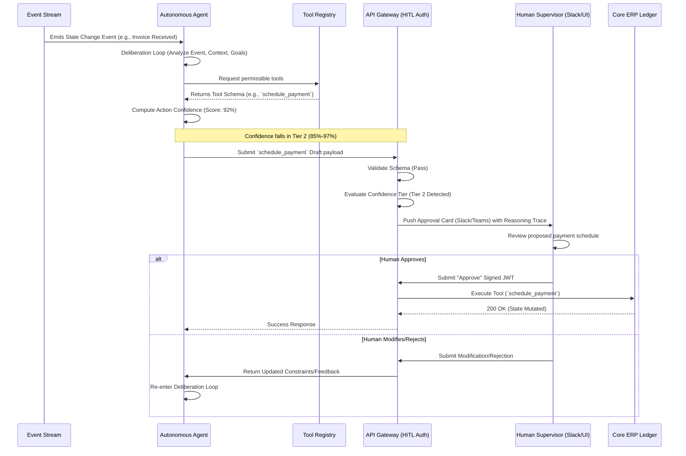

# AI-Native Agentic Workflows & Autonomous Ops

## 1. Executive Architecture & Paradigm Shift

For decades, Enterprise Resource Planning (ERP) systems have been structured around a monolithic paradigm: the user interface is a thin wrapper over relational database schemas, and workflows are fundamentally stateful, form-based Data Manipulation Language (DML) transactions. In this classic paradigm, human operators act as the primary orchestrators of business logic. They ingest external stimuli (emails, physical documents, phone calls), translate those stimuli into the system's ontology, and execute Create, Read, Update, Delete (CRUD) operations via static graphical interfaces.

The recent advent of conversational AI and "copilots" in enterprise software attempted to solve the friction of form-based data entry by layering a natural language interface over these legacy APIs. However, this chatbot paradigm fundamentally fails in mission-critical operations because it acts merely as a localized translation layer. A chatbot cannot autonomously navigate complex, multi-step state machines, nor can it proactively identify anomalies in background processes, orchestrate complex compensations, or uphold deterministic latency and idempotency guarantees. It is an interactive wrapper, not a systemic engine.

The evolution to AI-native agentic workflows represents a profound architectural paradigm shift from **Interactive State Manipulation** to **Autonomous Goal-Oriented Orchestration**. In this new architecture, the ERP ceases to be a passive repository of ledger entries and becomes an active, multi-agent runtime. The human is elevated from an operator to a supervisor, governing a swarm of specialized agents that continuously deliberate, act, and resolve state discrepancies without manual prompting.

At the core of this shift is the **"Action-as-a-Tool"** paradigm. Rather than exposing internal system states directly to the user interface, the ERP exposes highly decoupled, schema-validated, and idempotent functions designed explicitly for Large Language Model (LLM) function-calling capabilities. Every business operation—from creating a purchase order to reconciling a ledger anomaly—is isolated as a deterministic tool. Agents consume these tools dynamically, building their own execution graphs to achieve abstract objectives (e.g., "optimize this week's cash flow"). This architectural inversion decouples the *intent* (derived from unstructured data and goals) from the *execution* (deterministic, structured API calls), effectively turning the ERP into a dynamic compiler for business workflows.

This paradigm requires strict architectural invariants:
1. **Idempotency by Default:** Agents may retry, hallucinate, or crash. Every mutation tool must gracefully handle redundant execution without corrupting the ledger state.
2. **Schema-Enforced Determinism:** The boundaries between the non-deterministic LLM reasoning layer and the deterministic execution layer must be strictly governed by rigorous JSON schema validation.
3. **Observability as a First-Class Citizen:** Because the execution graph is generated at runtime, traditional APM (Application Performance Monitoring) is insufficient. The system must capture reasoning tokens, prompts, and tool inputs in a cryptographic audit trail.

## 2. The Agent Tool Registry & Function-Calling Interface

To facilitate the Action-as-a-Tool paradigm, the enterprise architecture requires a centralized **Agent Tool Registry**. This registry serves as the definitive catalog of all permissible actions within the ERP, exposing them to the agentic orchestration layer through machine-readable contracts. These contracts are not merely API definitions; they are semantic interfaces that define the tool's purpose, its precise inputs, its deterministic outputs, and the business invariants it enforces.

Unlike traditional OpenAPI specifications intended for human developers, the Agent Tool Registry is optimized for LLM consumption. It employs rich, semantic descriptions for every parameter to minimize agent hallucination and ensure accurate tool selection during the deliberation loop. Furthermore, the registry enforces a strict validation perimeter: before an agent's request reaches the core ERP logic, it is validated against the registry's JSON Schema. Any deviation results in an immediate, structured error response, forcing the agent to self-correct its payload.

Below are three critical examples of how core ERP actions are exposed as schema-validated tools.

### 2.1. Tool Specification: `create_purchase_order`

The `create_purchase_order` tool allows an autonomous supply chain agent to proactively draft or issue purchase orders to vendors. Note the use of semantic descriptions and strict type enforcement to guide the LLM.

```json
{
  "name": "create_purchase_order",
  "description": "Idempotent tool to create a new Purchase Order (PO) for a specified vendor. Must be called when inventory drops below the dynamic reorder point or when fulfilling a back-to-back customer order. Requires a unique idempotency key.",
  "parameters": {
    "type": "object",
    "properties": {
      "vendor_id": {
        "type": "string",
        "description": "The unique UUID of the registered vendor."
      },
      "line_items": {
        "type": "array",
        "description": "List of items to order. Must contain at least one item.",
        "items": {
          "type": "object",
          "properties": {
            "sku": {
              "type": "string",
              "description": "The Stock Keeping Unit (SKU) identifier."
            },
            "quantity": {
              "type": "integer",
              "minimum": 1,
              "description": "The number of units to order. Must be a positive integer."
            },
            "unit_price_estimate": {
              "type": "number",
              "description": "Expected unit price based on the current vendor contract."
            }
          },
          "required": ["sku", "quantity", "unit_price_estimate"]
        }
      },
      "required_delivery_date": {
        "type": "string",
        "format": "date",
        "description": "ISO 8601 date format (YYYY-MM-DD) indicating the latest acceptable delivery date."
      },
      "idempotency_key": {
        "type": "string",
        "description": "A unique UUIDv4 generated by the agent to ensure duplicate requests do not create multiple POs."
      }
    },
    "required": ["vendor_id", "line_items", "required_delivery_date", "idempotency_key"],
    "additionalProperties": false
  }
}
```

### 2.2. Tool Specification: `reconcile_bank_transaction`

Reconciliation is traditionally a highly manual process. The `reconcile_bank_transaction` tool provides a strictly bounded mechanism for a continuous audit agent to match bank statement lines against internal ledger entries.

```json
{
  "name": "reconcile_bank_transaction",
  "description": "Reconciles a cleared bank transaction against an existing Accounts Receivable or Accounts Payable ledger entry. Applies only when the transaction amount matches the ledger entry precisely or falls within the acceptable tolerance threshold.",
  "parameters": {
    "type": "object",
    "properties": {
      "bank_transaction_id": {
        "type": "string",
        "description": "The UUID of the imported bank transaction."
      },
      "ledger_entry_id": {
        "type": "string",
        "description": "The UUID of the internal ledger entry (Invoice or Bill) to match against."
      },
      "reconciliation_type": {
        "type": "string",
        "enum": ["exact_match", "tolerance_match", "partial_payment"],
        "description": "The strategy used to match the transaction. 'exact_match' requires identical amounts."
      },
      "agent_confidence_score": {
        "type": "number",
        "minimum": 0.0,
        "maximum": 1.0,
        "description": "The agent's computed confidence probability that this is the correct match. Must be passed for HITL governance routing."
      }
    },
    "required": ["bank_transaction_id", "ledger_entry_id", "reconciliation_type", "agent_confidence_score"],
    "additionalProperties": false
  }
}
```

### 2.3. Tool Specification: `flag_expense_anomaly`

When anomalous behavior is detected, agents must not silently fix issues that require human investigation. The `flag_expense_anomaly` tool shifts the state of an expense report into a quarantined queue.

```json
{
  "name": "flag_expense_anomaly",
  "description": "Flags an expense report or AP invoice for human review. Moves the entity to the Tier 3 Quarantined state. Used when policy violations are detected or when vendor risk scores exceed acceptable thresholds.",
  "parameters": {
    "type": "object",
    "properties": {
      "expense_id": {
        "type": "string",
        "description": "The UUID of the expense report or invoice."
      },
      "anomaly_category": {
        "type": "string",
        "enum": ["duplicate_submission", "out_of_policy", "unrecognized_vendor", "statistical_outlier"],
        "description": "The category of the detected anomaly."
      },
      "reasoning_trace": {
        "type": "string",
        "description": "A detailed explanation of the agent's reasoning for flagging this expense, which will be displayed to the human reviewer."
      },
      "severity_level": {
        "type": "string",
        "enum": ["low", "medium", "critical"],
        "description": "The severity of the anomaly based on financial impact."
      }
    },
    "required": ["expense_id", "anomaly_category", "reasoning_trace", "severity_level"],
    "additionalProperties": false
  }
}
```

These schemas are not mere documentation; they are active enforcement layers. At runtime, the API gateway validates the agent's output against the schema before invoking the backend service. If the payload is malformed, the gateway rejects the request with a `400 Bad Request` and detailed error messages, allowing the agentic deliberation loop to self-correct and retry the tool invocation. This deterministic boundary is essential for reliable autonomous operations.


## 3. Core Autonomous Enterprise Agents (Deep Dive)

The realization of the Action-as-a-Tool paradigm enables the deployment of specialized, autonomous agents that operate continuously across the enterprise ledger. These agents are not monolithic scripts; they are discrete, objective-driven entities that subscribe to event streams, deliberate over state changes, and execute tools to maintain business invariants. In mid-market and enterprise B2B operations—such as Wholesale Distribution, SaaS, and Light Manufacturing—these agents govern the critical triad of operational viability: Cash Flow, Supply Chain, and Accounts Receivable.

### 3.1. Cash Flow & Working Capital Optimizer

The Cash Flow Optimizer is an agent tasked with dynamically managing liquidity. Traditional ERPs provide static cash flow projections based on due dates. The autonomous optimizer operates dynamically, continuously recalculating the company's runway risk by analyzing real-time AP obligations, AR aging, and historical payment probabilities.

When working capital drops below a defined safety threshold, the agent does not merely alert a dashboard; it takes programmatic action. It can utilize tools like `delay_vendor_payment` or `initiate_early_payment_discount`.

**Event Trigger Payload:**
```json
{
  "event_id": "evt_cf_9876",
  "event_type": "working_capital_breach",
  "timestamp": "2023-11-14T09:00:00Z",
  "payload": {
    "current_liquidity": 245000.00,
    "projected_outflows_7d": 180000.00,
    "projected_inflows_7d": 40000.00,
    "safety_threshold": 150000.00
  }
}
```

**Agent Output (Tool Execution):**
In response, the agent queries upcoming non-critical vendor payouts and executes a delay tool to preserve capital.
```json
{
  "tool_call": "update_payment_schedule",
  "arguments": {
    "vendor_id": "vnd_acme_corps",
    "invoice_id": "inv_54321",
    "new_payment_date": "2023-11-21",
    "reasoning_trace": "Projected liquidity deficit of 45k on Nov 18. Acme Corp terms allow NET60, currently at day 45. Delaying payment by 7 days incurs no penalty and preserves necessary capital."
  }
}
```

### 3.2. Autonomous Supply Chain & Stockout Healer

In wholesale and manufacturing environments, stockouts represent immediate revenue loss. The Supply Chain agent continuously monitors inventory levels against dynamic demand forecasts and transit data. If it detects an impending stockout due to a supplier delay or a sudden spike in demand, it operates as a self-healing system.

This agent utilizes tools like `create_purchase_order` (as defined in Section 2) or `draft_rfq` (Request for Quote) to source alternative suppliers autonomously.

**Event Trigger Payload:**
```json
{
  "event_id": "evt_inv_4432",
  "event_type": "transit_delay_detected",
  "timestamp": "2023-11-14T10:15:00Z",
  "payload": {
    "po_id": "po_88776",
    "sku": "WIDGET-X-100",
    "original_eta": "2023-11-16",
    "revised_eta": "2023-11-26",
    "current_stock": 450,
    "daily_burn_rate": 50
  }
}
```

**Agent Output (Tool Execution):**
The agent calculates that stock will deplete by Nov 23, three days before the revised ETA. It drafts an expedited PO with an alternative domestic supplier to bridge the gap.
```json
{
  "tool_call": "create_purchase_order",
  "arguments": {
    "vendor_id": "vnd_fast_supply",
    "line_items": [
      {
        "sku": "WIDGET-X-100",
        "quantity": 150,
        "unit_price_estimate": 12.50
      }
    ],
    "required_delivery_date": "2023-11-22",
    "idempotency_key": "c3f8e5b2-1a4d-4b9c-8e2f-7a1b9c3d8e5f"
  }
}
```

### 3.3. Proactive AR Collections & Dunning Agent

Accounts Receivable is often a bottleneck in B2B operations. The Proactive AR agent operates a continuous dunning process, dynamically tailoring its communication strategy based on the client's payment history, risk profile, and relationship value. Rather than sending static 30/60/90-day templates, the agent customizes follow-ups and negotiates minor payment plans autonomously within predefined boundaries.

**Event Trigger Payload:**
```json
{
  "event_id": "evt_ar_5544",
  "event_type": "invoice_past_due",
  "timestamp": "2023-11-14T11:00:00Z",
  "payload": {
    "customer_id": "cust_omega_llc",
    "invoice_id": "inv_99887",
    "amount_due": 15000.00,
    "days_past_due": 10,
    "historical_avg_days_late": 12
  }
}
```

**Agent Output (Tool Execution):**
Recognizing that Omega LLC routinely pays 12 days late, the agent selects a softer touch rather than escalating immediately to aggressive collections, utilizing a tool to draft and send a tailored email.
```json
{
  "tool_call": "send_dunning_communication",
  "arguments": {
    "customer_id": "cust_omega_llc",
    "invoice_id": "inv_99887",
    "tone": "polite_reminder",
    "generated_body": "Hi Team, friendly reminder that invoice INV-99887 for $15,000 is currently 10 days past due. We know you usually process these mid-month, so please let us know if you need another copy of the invoice.",
    "channel": "email"
  }
}
```

### 3.4. Continuous Audit & Anomaly Detection Agent

The Continuous Audit agent operates orthogonally to the operational agents. Its mandate is governance and risk management. It continuously scans the ledger, looking for statistical outliers, policy violations, or suspicious modifications. When it detects an anomaly, it utilizes the `flag_expense_anomaly` tool to quarantine the transaction and halt any further automated processing, effectively acting as an internal immune system.

**Event Trigger Payload:**
```json
{
  "event_id": "evt_aud_1122",
  "event_type": "ap_invoice_ingested",
  "timestamp": "2023-11-14T14:30:00Z",
  "payload": {
    "invoice_id": "inv_ap_77665",
    "vendor_id": "vnd_new_services",
    "amount": 45000.00,
    "category": "consulting"
  }
}
```

**Agent Output (Tool Execution):**
The agent detects a first-time vendor submitting a massive invoice that exceeds standard consulting limits, tripping a statistical threshold.
```json
{
  "tool_call": "flag_expense_anomaly",
  "arguments": {
    "expense_id": "inv_ap_77665",
    "anomaly_category": "statistical_outlier",
    "reasoning_trace": "Vendor vnd_new_services has no prior history. Invoice amount $45,000 exceeds the 99th percentile for initial consulting invoices ($15,000). Quarantining for human AP Manager review.",
    "severity_level": "critical"
  }
}
```

These agents operate concurrently, forming a multi-agent system where the output of one agent (e.g., a delayed payment by the Cash Flow Optimizer) becomes the state input for another (e.g., the Audit Agent ensuring the delay doesn't breach a critical vendor SLA).


## 4. Human-in-the-Loop (HITL) Governance & Risk Tiering

The transition to autonomous operations necessitates a fundamental redesign of governance models. Legacy RBAC (Role-Based Access Control) systems are binary: a user either has permission to perform an action or does not. In an agentic architecture, authorization must be dynamic, probabilistic, and risk-adjusted. Agents operate with varying degrees of confidence depending on the clarity of the inputs and the complexity of the desired state change.

To manage this, the system implements a strict **3-Tier Confidence Model** that governs when an agent may execute an action autonomously and when it must escalate to a human. This model aligns directly with the perception layer confidence scoring defined in Document 14 (`14_multimodal_unstructured_intake.md`), creating a unified risk perimeter from ingestion to execution.

### 4.1. The 3-Tier Confidence Model

1. **Tier 1 (Autonomous Execution): $\ge 98\%$ Confidence + Invariant Pass**
   - **Criteria:** The agent computes a confidence score of $\ge 98\%$ regarding the proposed action *and* all mathematical invariants (e.g., exact match between PO, Goods Receipt Note, and Invoice amounts) pass.
   - **Action:** The system automatically executes the tool, commits the transaction to the ledger, and logs the action. No human intervention occurs.
   - **Example:** Auto-reconciling a $500 utility bill where the vendor, amount, and date perfectly match the recurring PO and the extracted PDF data.

2. **Tier 2 (Assisted / One-Click Approval): $85\% - 97\%$ Confidence**
   - **Criteria:** The agent is reasonably confident in the proposed action but lacks the certainty required for autonomous mutation, or the action involves a sensitive state change (e.g., moving funds above a specific threshold).
   - **Action:** The system pauses the execution graph. The agent drafts the intended state change and sends a localized notification (via Slack, MS Teams, or an embedded UI card) to the authorized human supervisor. The human can approve ("One-Click"), modify, or reject the action.
   - **Example:** Drafting a response to a frustrated customer regarding a delayed shipment. The agent writes the email but requires a human Account Manager to click "Approve & Send."

3. **Tier 3 (Quarantined / Human Investigation): $< 85\%$ Confidence or Anomalous Pattern**
   - **Criteria:** The agent is unable to determine a safe course of action, the confidence score drops below 85%, or a circuit breaker is tripped (e.g., the Audit Agent flags a statistical anomaly).
   - **Action:** The workflow is entirely halted. The entity is moved into a quarantined state and assigned to a human investigation queue. The agent provides its reasoning trace and the specific point of failure to accelerate human resolution.
   - **Example:** An invoice is received from an unknown vendor for an amount that deviates significantly from historical department spend.

### 4.2. HITL Escalation Sequence

The following Mermaid.js sequence diagram illustrates the deliberation loop and the escalation path when a Tier 2 confidence threshold is met, requiring a one-click approval before a state mutation occurs.



## 5. Cryptographic Audit Trail & Observability

In a deterministic, form-based ERP, auditing is straightforward: record the `user_id`, the timestamp, and the delta of the database row. In an autonomous, agentic system, this is profoundly insufficient. When the system state is mutated, auditors and engineers must be able to answer not just *who* made the change and *when*, but *why* the AI decided to make the change based on its non-deterministic reasoning process.

To achieve compliance (e.g., SOX, SOC 2) and operational debuggability, the system must implement a Cryptographic Audit Trail. This trail records the entire context of the agent's decision-making process as an immutable ledger entry.

### 5.1. The Audit Payload Schema

Every tool execution, regardless of whether it is Tier 1, 2, or 3, must generate a standardized audit record. This record binds the semantic intent (the prompt and reasoning) to the deterministic execution (the tool payload).

```json
{
  "audit_id": "aud_99887766",
  "timestamp": "2023-11-14T15:05:22Z",
  "execution_context": {
    "agent_id": "agt_cash_flow_optimizer_v2",
    "model_version": "gpt-4-turbo-2024-04-09",
    "trigger_event_id": "evt_cf_9876",
    "confidence_score": 0.99,
    "tier_classification": "Tier_1"
  },
  "reasoning_trace": {
    "system_prompt_hash": "sha256:d3b07384d113edec49eaa6238ad5ff00",
    "context_window_tokens": 4502,
    "deliberation_summary": "Calculated liquidity deficit on Nov 18. Evaluated options. Selected vendor payment delay as optimal path with zero penalty.",
    "raw_llm_response_hash": "sha256:f520d2d3a3d548325a74070a7b45a2fa"
  },
  "deterministic_action": {
    "tool_name": "update_payment_schedule",
    "payload": {
      "vendor_id": "vnd_acme_corps",
      "invoice_id": "inv_54321",
      "new_payment_date": "2023-11-21"
    },
    "idempotency_key": "8f7e6d5c-4b3a-2109-fedc-ba9876543210"
  },
  "governance": {
    "human_approver_id": null,
    "approval_timestamp": null,
    "approval_jwt_signature": null
  }
}
```

### 5.2. Observability Guarantees

1. **Prompt Reproducibility:** By storing the hash of the system prompt and the exact state of the context window, engineers can replay the exact scenario in a staging environment to debug agent hallucinations or suboptimal decisions.
2. **Cryptographic Signatures:** For Tier 2 actions, the `human_approver_id` is bound to a cryptographic signature (e.g., a JWT signed by the user's session) guaranteeing non-repudiation of the human's consent to the AI's proposed action.
3. **Token Accounting:** Tracking token usage per action enables the finance team to attribute inference costs directly to specific business processes (e.g., calculating the computing cost to autonomously resolve a single invoice).


## 6. Failure Recovery & State Rollbacks

The fundamental nature of Large Language Models introduces stochasticity into a previously deterministic system. Agents will occasionally hallucinate incorrect tool parameters, misinterpret context, or encounter transient API failures. Therefore, an AI-native ERP must be engineered defensively, anticipating that the execution graph will fail. The system must guarantee that partial failures do not leave the ledger in an inconsistent or corrupted state.

### 6.1. Idempotent Retries

The foundational layer of failure recovery is strict idempotency. Every tool in the registry must require a client-generated `idempotency_key` (typically a UUIDv4 generated by the agent).

If an agent encounters a network timeout while calling `create_purchase_order`, it cannot know if the backend successfully processed the request before the connection dropped. With idempotency enforced at the gateway layer, the agent can safely retry the exact same payload (including the same key). The gateway will recognize the duplicate key and either return the cached success response (if the previous attempt succeeded) or process the new request (if the previous attempt failed), guaranteeing that only one Purchase Order is created.

### 6.2. Compensating Transactions (Sagas)

In distributed, agentic workflows, an operation often spans multiple discrete tool calls. Traditional monolithic database transactions (ACID commits/rollbacks) cannot span across these protracted, multi-step asynchronous processes. Instead, the architecture utilizes the **Saga Pattern**.

If an agent begins a complex workflow—such as onboarding a new vendor, which involves calling `create_vendor_profile`, `initiate_kyc_check`, and `schedule_initial_payment`—and fails on the third step, it cannot simply "rollback" the database. It must execute *compensating transactions*.

The Tool Registry enforces that every state-mutating tool must have a defined inverse operation. If `schedule_initial_payment` fails because of insufficient liquidity logic, the orchestrator forces the agent (or a dedicated recovery supervisor) to execute the compensating tools: `cancel_kyc_check` and `archive_vendor_profile`, returning the system to its initial semantic state.

### 6.3. Agent Hallucination Circuit Breakers

Despite semantic tool descriptions and strict schema validation, an agent may repeatedly hallucinate payloads that fail validation, entering an infinite loop of `400 Bad Request` errors. To prevent this, the API gateway implements **Hallucination Circuit Breakers**.

1. **Retry Thresholds:** If an agent attempts to execute a tool and fails schema validation three consecutive times for the same objective, the circuit breaker trips.
2. **Forced Hault:** The gateway rejects further attempts with a `429 Too Many Requests` or specific `423 Locked` status, preventing infinite token burn.
3. **Dead-Letter Routing:** The failed objective, along with the agent's reasoning trace and the schema validation errors, is routed to a Dead-Letter Queue (DLQ).
4. **Human Intervention:** Items in the DLQ are surfaced in the Tier 3 Quarantined interface, requiring an engineer to review the hallucination, potentially patch the tool schema description to be clearer, and manually resolve the blocked workflow.

### 6.4. The Dead-Letter Queue (DLQ) State

When a workflow is routed to the DLQ via a circuit breaker, the system preserves the exact state of the failure. This prevents data loss and allows asynchronous recovery.

```json
{
  "dlq_id": "dlq_55443322",
  "timestamp": "2023-11-14T16:20:00Z",
  "failing_agent": "agt_supply_chain_healer",
  "attempted_tool": "create_purchase_order",
  "failure_reason": "circuit_breaker_tripped",
  "validation_errors": [
    "$.line_items[0].quantity: Must be greater than or equal to 1"
  ],
  "last_attempted_payload": {
    "vendor_id": "vnd_fast_supply",
    "line_items": [
      {
        "sku": "WIDGET-X-100",
        "quantity": 0,
        "unit_price_estimate": 12.50
      }
    ],
    "required_delivery_date": "2023-11-22",
    "idempotency_key": "a1b2c3d4-e5f6-7890-1234-567890abcdef"
  },
  "recovery_status": "pending_human_review"
}
```

By embedding these recovery mechanisms natively into the architecture, the ERP abstracts the inherent unreliability of LLMs, providing a robust, deterministic operational guarantee even when the orchestrating intelligence is probabilistic.
