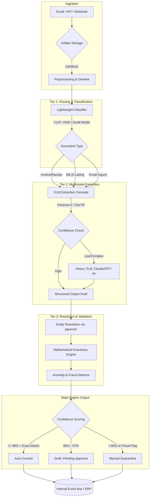
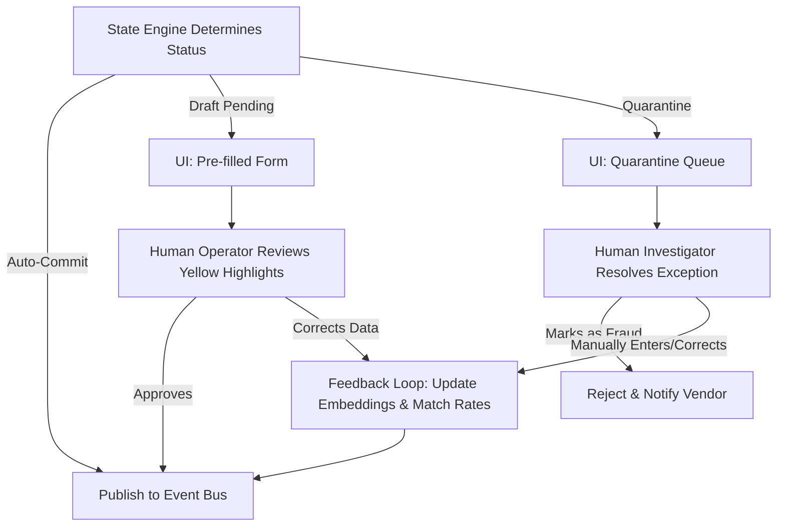

# Multimodal Ingestion & Zero-Manual-Data-Entry Engine

## 1. System Overview

This document outlines the architecture and implementation details for a highly scalable, zero-manual-data-entry ingestion engine. The system is designed to consume unstructured multimodal inputs—including scanned vendor invoices, bills of lading, physical receipts, customs declarations, handwritten notes, and inbound customer emails—and autonomously convert them into canonical, structured, standardized JSON payloads.

Built as the core ingestion engine for a modern Business OS, the system relies on a cloud-agnostic, hybrid Vision-Language Model (VLM) architecture. It validates outputs via strict mathematical rules and semantic embedding verification, seamlessly interfacing with internal event buses and ERP adapters.

---

## 2. End-to-End Ingestion Pipeline

The processing lifecycle leverages a tiered cascade approach to optimize latency, cost, and accuracy.



---

## 3. Technology Stack & Storage Architecture

The architecture adheres to a cloud-agnostic, best-of-breed hybrid model.

### Model Layer (Tiered Cascade Strategy)
*   **Tier 1 - Classification & Routing:** Lightweight local classifiers (e.g., CLIP, KNN, or fine-tuned compact models) aggressively categorize inbound documents with low latency.
*   **Tier 2 - Primary Extraction (Open-Weights):** Florence-2, DocTR, and Qwen2-VL are deployed (self-hosted) for baseline OCR, layout analysis, and dense text extraction.
*   **Tier 3 - Fallback/Complex Reasoning (Commercial VLMs):** Claude 3.5/3.7 Sonnet or GPT-4o are invoked on-demand when the open-weights models fail to exceed confidence thresholds or for deeply complex reasoning tasks (e.g., extracting intent from highly unstructured emails).

### Persistence & Vector Search
*   **Artifact Storage:** S3-compatible object storage (e.g., MinIO for on-prem or AWS S3). Retains the immutable original artifact alongside the preprocessed/deskewed images.
*   **Relational & Vector Store:** PostgreSQL extended with `pgvector` for both structured transaction persistence and semantic embeddings, enabling ultra-fast supplier and internal SKU entity resolution.

---

## 4. Intelligent Entity Resolution

Transforming vendor-provided part descriptions into internal, canonical SKUs requires semantic intelligence rather than brittle regex rules.

1.  **Vendor Context:** Identifies the supplier from metadata or logo extraction and queries the known entity registry.
2.  **Semantic Vector Matching:** Generates embeddings for the extracted line-item descriptions using lightweight embedding models (e.g., `BGE-M3` or `all-MiniLM-L6-v2`).
3.  **Vector Search:** Performs a cosine similarity search against internal SKU embeddings in PostgreSQL (`pgvector`).
4.  **Thresholds:** Matches scoring **> 0.92** are considered deterministic candidates for Auto-Commit, provided historical match rates for the specific vendor/SKU pair support the hypothesis.

---

## 5. Mathematical & Heuristic Validation

To prevent downstream accounting failures, extracted numeric data must be reconciled mathematically.

*   **Financial Exactness:** The system rigorously computes `Sum(Line Items) + Tax + Freight + Discounts = Total`.
*   **Tax ID Verification:** Extracted Vendor VAT/GST/Tax IDs must strictly string-match against verified records stored in the ERP vendor master.
*   **Date Sanity:** Document dates, delivery dates, and payment terms must align logically (e.g., Invoice Date $\le$ Delivery Date $\le$ Due Date).

---

## 6. Strict Three-Tiered Financial Validation & HITL Workflow

Output states strictly adhere to predefined confidence and validation rules to balance automation with compliance.

### The Validation Tiers

1.  **Auto-Commit / Auto-Approve:**
    *   *Criteria:* Overall extraction confidence $\ge 98\%$.
    *   *Math:* Exact mathematical reconciliation ($Subtotal + Tax \equiv Total$).
    *   *Entity:* Vendor Tax ID matches perfectly. All SKU embeddings $\ge 0.92$ similarity.
    *   *Action:* Injected directly into the Event Bus as a finalized transaction. No human intervention required.
2.  **Draft Pending One-Click Approval:**
    *   *Criteria:* Overall confidence between $85\%$ and $97\%$, OR minor entity ambiguity (e.g., SKU similarity $0.85 - 0.91$).
    *   *Action:* Data is drafted and pre-filled into the frontend UI. Uncertain fields are visually highlighted in yellow for a human operator to perform a rapid "One-Click Approve."
3.  **Manual Quarantine / Review Queue:**
    *   *Criteria:* Overall confidence $< 85\%$, missing mandatory fields, mathematical mismatch, duplicate invoice number hash, or a raised Fraud/Anomaly flag.
    *   *Action:* Payload is quarantined in the review queue.

### Human-in-the-Loop (HITL) Fallback Workflow



---

## 7. Anomaly and Fraud Detection

The intake pipeline actively audits artifacts for visual and contextual inconsistencies:
*   **Visual Alteration Detection:** Analyzes noise patterns, font inconsistencies, and compression artifacts to detect tampered prices or manipulated banking details.
*   **Duplication Hashes:** Generates a composite hash `Hash(VendorID + InvoiceNumber + TotalAmount + Date)`. Matches trigger immediate Quarantine.
*   **Timestamp Inconsistencies:** Flags receipts processed on dates preceding their creation or anomalies like a Sunday 3:00 AM delivery from a standard B2B vendor.

---

## 8. API Contracts & TypeScript Schemas

The engine outputs standardized, canonical JSON. Below are the core TypeScript schemas defining the extraction payloads and validation envelopes.

```typescript
// Core Data Types
export type DocumentType = 'INVOICE' | 'RECEIPT' | 'PURCHASE_ORDER' | 'BILL_OF_LADING' | 'SALES_QUOTE';

export interface ExtractedLineItem {
  rawDescription: string;
  matchedInternalSku: string | null;
  skuConfidenceScore: number;
  quantity: number;
  unitPrice: number;
  totalPrice: number;
  taxAmount: number;
}

export interface DocumentPayload {
  documentId: string;
  sourceUri: string; // S3/MinIO URI
  documentType: DocumentType;
  vendorId: string | null;
  extractedVendorTaxId: string | null;
  dateIssued: string; // ISO8601
  dueDate: string | null;
  lineItems: ExtractedLineItem[];
  subtotal: number;
  totalTax: number;
  totalAmount: number;
}

// Validation & Confidence Envelopes
export type ValidationState = 'AUTO_COMMIT' | 'DRAFT_PENDING' | 'QUARANTINE';

export interface AnomalyReport {
  isDuplicate: boolean;
  visualAlterationDetected: boolean;
  mathMismatch: boolean;
  flags: string[];
}

export interface IngestionResult {
  state: ValidationState;
  overallConfidence: number;
  payload: DocumentPayload;
  mathValidationPassed: boolean;
  anomalies: AnomalyReport;
  highlightedFields: string[]; // e.g. ["lineItems[0].matchedInternalSku", "vendorId"]
}
```
