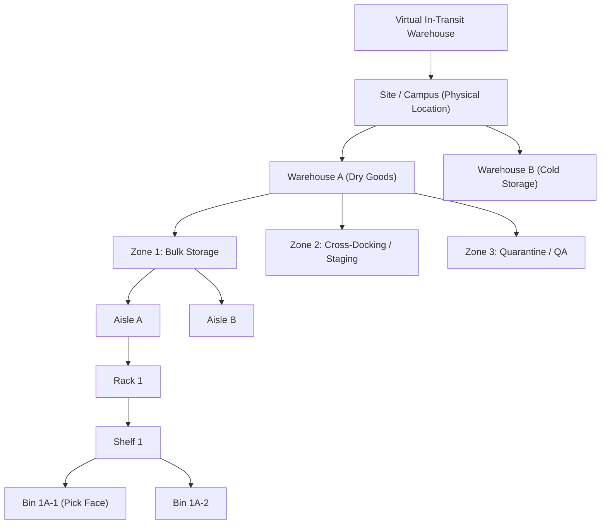
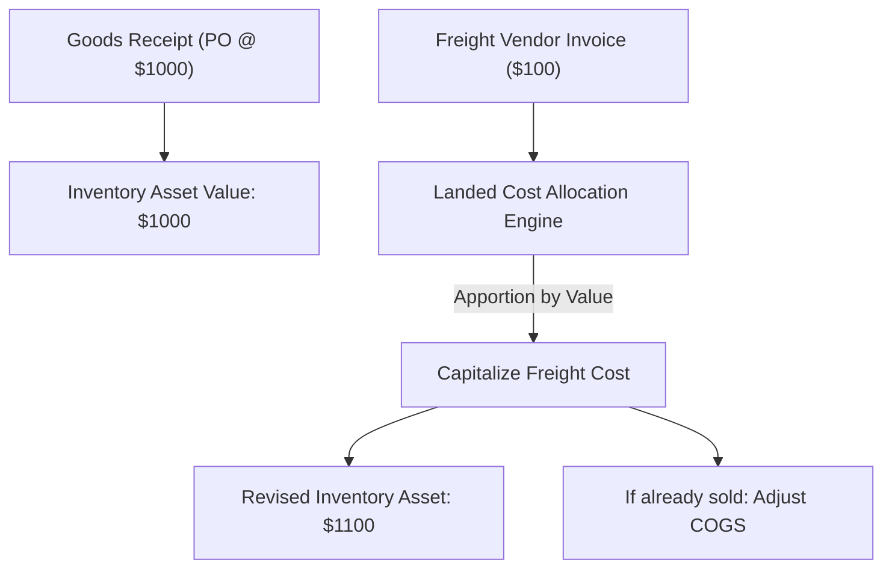
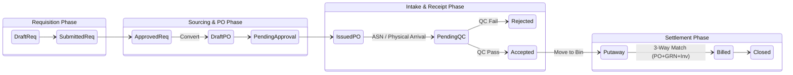

# Procurement, SCM & Inventory Blueprint: Architectural Synthesis

This document analyzes procurement and inventory structures across SAP MM, NetSuite SCM, Katana, Odoo Inventory, and Zoho Inventory to define a canonical architectural standard. It focuses on functional schemas and systems design rather than vendor-specific workflows.

---

## 1. Item & SKU Master Data Architecture

The bedrock of any SCM ecosystem is the multidimensional Item Master. It must handle varying material typologies, nested variants, and robust unit-of-measure (UOM) conversions.

### Material Typology Framework
* **Stock Item:** Physical inventoried items requiring complete lifecycle tracking and cost valuation.
* **Non-Stock Item:** Items purchased for consumption or direct expense (e.g., office supplies) that bypass inventory valuation ledgers.
* **Service:** Non-physical deliverables, purely utilized in Procure-to-Pay (P2P) billing or Order-to-Cash.
* **Assembly/Kit (BOM):** Multi-component items grouped for sales or production.
* **Serialized/Batched:** Materials requiring strict traceability identifiers per unit or lot.

### Multi-Tier Unit of Measure (UOM) Conventions
Systems must decouple the logical quantities used in purchasing, stocking, and selling. A static conversion matrix prevents rounding errors during transactional workflows.
* **Base/Stock UOM:** The lowest denominator tracked in warehouse bins (e.g., "EA" or "Ea"). All valuation metrics rest upon the Base UOM.
* **Purchase UOM:** The aggregate unit bought from vendors (e.g., "Pallet" or "Box of 100").
* **Sales UOM:** The aggregate unit sold to customers.

**UOM Invariant:** The relationship must always define the conversion factor strictly relative to the Base UOM:
`Purchase Qty * Conversion Factor = Stock Qty`

### Real-World System Mappings: Item Master Data
| Feature/Entity | SAP MM | NetSuite SCM | Katana | Odoo | Zoho Inventory |
| :--- | :--- | :--- | :--- | :--- | :--- |
| **Core Entity** | `MARA` (General), `MARC` (Plant) | `Item` (Inventory, Non-Inv, Kit) | `Variant`, `Material`, `Product` | `product.template`, `product.product` | `items`, `composite_items` |
| **Variants** | Configurable Materials (Variant Configuration) | Matrix Items | Item Variants | Attributes & Variants | Item Groups & Variants |
| **UOM Handling** | `MARM` (UOM conversions base vs alt) | Multiple Units of Measure feature | Dedicated purchase/sales UOM | UOM Categories (Ratio based) | UOM mapping in Items |

---

## 2. Warehouse Topologies & Spatial Hierarchy

Proper inventory management necessitates a discrete, multi-tier spatial model to reflect the physical reality of the warehouse, facilitating bin-level putaway, cross-docking, and dynamic routing.

### Spatial Topography Diagram


### Specialized Locations
* **Cross-Docking Zones:** Temporary staging areas where inbound shipments are immediately routed to outbound shipping docks without bin putaway.
* **Quarantine / QA Locations:** Locked locations where stock is physically present but logically restricted from sales allocation or manufacturing issuance.
* **Virtual In-Transit Locations:** Used to hold title to inventory while on the water or over-the-road between facilities (Stock Transport Orders).

### Real-World System Mappings: Topology
| Feature/Entity | SAP MM | NetSuite SCM | Katana | Odoo | Zoho Inventory |
| :--- | :--- | :--- | :--- | :--- | :--- |
| **Spatial Model** | Plant (`WERKS`) $\rightarrow$ SLoc (`MARD`) $\rightarrow$ Warehouse (`WM/EWM`) $\rightarrow$ Storage Type $\rightarrow$ Bin | Location $\rightarrow$ Zone $\rightarrow$ Bin | Locations | Warehouse (`stock.warehouse`) $\rightarrow$ Location (`stock.location`) | Warehouses |
| **Quarantine** | Blocked Stock Status / QA SLoc | Status/Bin limitation | Not heavily formalized | Quality Control Points / Scrap Locs | Not explicitly mapped structurally |

---

## 3. Inventory Valuation & Costing Engines

Accurate costing is the bridge between operations and the general ledger. Systems must define rules for capitalizing costs into the inventory asset account versus expensing them.

### Costing Valuation Models
1. **Moving Average Cost (MAC):** Continuously recalculates the blended cost of inventory on hand after every goods receipt. Best for volatile commodities.
   $$ \text{New Cost} = \frac{(\text{Current Qty} \times \text{Current Cost}) + (\text{Received Qty} \times \text{Purchase Price})}{\text{Current Qty} + \text{Received Qty}} $$
2. **FIFO (First-In, First-Out):** Values issues and shipments based on the exact historical cost layers of the oldest units received.
3. **Standard Costing:** Fixes the inventory value for a period. Variances between PO price and standard cost are posted to a Purchase Price Variance (PPV) expense account. Typical in manufacturing.

### Landed Cost Capitalization Workflow
Landed costs (freight, duties, insurance, port handling) occur post-receipt. They must be apportioned across the received goods to correctly state the asset value.

#### Apportionment Algorithms
The allocated cost for a specific item line $i$ based on a chosen method:

* **By Value:**
  $$ \text{Allocated Cost}_i = \text{Total Landed Cost} \times \frac{\text{Line Value}_i}{\sum (\text{Total PO Value})} $$
* **By Quantity:**
  $$ \text{Allocated Cost}_i = \text{Total Landed Cost} \times \frac{\text{Line Quantity}_i}{\sum (\text{Total PO Quantity})} $$
* **By Weight:**
  $$ \text{Allocated Cost}_i = \text{Total Landed Cost} \times \frac{\text{Line Weight}_i}{\sum (\text{Total PO Weight})} $$



### Real-World System Mappings: Valuation
| Platform | Supported Valuation | Landed Costs |
| :--- | :--- | :--- |
| **SAP MM** | Standard (`S`), Moving Avg (`V`), FIFO/LIFO | Freight condition types in Pricing Schema |
| **NetSuite** | Standard, Average, FIFO, LIFO, Specific | Landed Cost sub-tab on Item Receipt |
| **Katana** | Moving Average (MAC) | Partial manual handling / limited |
| **Odoo** | Standard, AVCO (Average), FIFO | Dedicated Landed Costs module & Apportionment |
| **Zoho** | FIFO, Moving Average | Landed costs applied at Bill creation |

---

## 4. Traceability, Lot/Batch & Serialized Controls

Stringent control over batch origins and serialization is non-negotiable for medical, F&B, and high-tech supply chains.

### Granularity Levels
* **Lot / Batch Number:** Represents a homogeneous quantity of material produced or received under identical conditions. Tracks generic manufacturing dates, supplier lot IDs, and expiration dates.
* **Serial Number:** A unique identifier for a *single quantity unit* (Qty = 1).

### Operational Controls
* **Shelf-Life & FEFO (First Expired, First Out):** Systematically routing picking logic to deplete lots closest to their expiration date (`FEFO > FIFO`).
* **Split & Merge Mechanics:** Breaking a large supplier lot into smaller internal sub-lots, or blending lots in a mixer. Must maintain a genealogical link (Lot Lineage) to trace recalls backwards to the supplier and forwards to the customer.
* **Quarantine Status:** A boolean or status layer on the lot restricting its use, independent of its physical bin location.

### Real-World System Mappings: Traceability
| Feature/Entity | SAP MM | NetSuite SCM | Katana | Odoo | Zoho Inventory |
| :--- | :--- | :--- | :--- | :--- | :--- |
| **Batch/Lot** | `MCH1` / `MCHA` / `MCHB` | `InventoryNumber` | Batch tracking module | `stock.lot` | Advanced Inventory tracking |
| **Serial** | Equipment Master (`EQUI`) | `InventoryNumber` (Serialized Item) | Serial Number tracking | `stock.lot` (Serial constraint) | Serialized tracking |

---

## 5. Procure-to-Pay (P2P) Lifecycle & State Machine

The P2P cycle maps the rigid pipeline governing how external spend is authorized, received physically, and settled financially.

### Workflow Nuances Across Platforms
While a canonical state machine exists, specific platforms handle the P2P flow with different philosophical approaches:
* **SAP MM** utilizes heavily structured release strategies (approval matrices) and strict, rigid MIGO material documents for receipts, making it highly controlled but complex.
* **Odoo** favors a highly streamlined routing system where the receipt can be modeled as simple 1-step, 2-step (Input $\rightarrow$ Stock), or 3-step (Input $\rightarrow$ Quality $\rightarrow$ Stock) picking routes.
* **NetSuite** standardizes around the `ItemReceipt` transaction, which provides a flexible link between the Purchase Order and Vendor Bill for the 3-way match.

### The Generalized Best-Practice State Machine



### Key Workflow Invariants & Concepts
* **3-Way Match Verification:** The foundational control preventing overpayment. The system strictly compares: `PO Qty/Price` $\leftrightarrow$ `Goods Receipt Qty` $\leftrightarrow$ `Vendor Invoice Qty/Price`. Variances outside defined tolerances block payment.
* **ASN (Advanced Shipping Notice):** A pre-receipt notification (often via EDI) signaling inbound transit, allowing the warehouse to pre-allocate cross-docking or dock doors before arrival.
* **Vendor Return (Debit Note):** If goods fail QC or are returned post-receipt, the system reverses the inventory receipt (`-1`) and issues a Debit Memo to the AP subledger to claw back the vendor payment.

### Real-World System Mappings: P2P
| Feature/Entity | SAP MM | NetSuite SCM | Katana | Odoo | Zoho Inventory |
| :--- | :--- | :--- | :--- | :--- | :--- |
| **Core PO** | `EKKO` / `EKPO` | `PurchaseOrder` | `PurchaseOrder` | `purchase.order` | `purchaseorders` |
| **Receipt / GRN** | `MIGO` / `MSEG` / `MATDOC` | `ItemReceipt` | `PurchaseOrderRow` received | `stock.picking` (In) | Receives/Bills |
| **Vendor Bill** | `MIRO` | `VendorBill` | Invoices / API Sync | `account.move` (Vendor Bill) | `bills` |

---

## 6. Canonical Business OS SCM Schema & Operational Invariants

To operationalize these concepts, the following is a normalized PostgreSQL blueprint modeling the core constraints of the Business OS.

### Canonical DDL (PostgreSQL)

```sql
-- 1. Item Master Definition
CREATE TABLE scm_items (
    item_id UUID PRIMARY KEY DEFAULT gen_random_uuid(),
    sku VARCHAR(100) UNIQUE NOT NULL,
    description TEXT,
    item_type VARCHAR(50) CHECK (item_type IN ('STOCK', 'NON_STOCK', 'ASSEMBLY', 'SERVICE')),
    base_uom_id UUID NOT NULL,
    is_serialized BOOLEAN DEFAULT FALSE,
    is_batched BOOLEAN DEFAULT FALSE,
    valuation_method VARCHAR(20) CHECK (valuation_method IN ('FIFO', 'MAC', 'STANDARD')),
    created_at TIMESTAMPTZ DEFAULT NOW()
);

-- 2. UOM Conversions
CREATE TABLE scm_uom_conversions (
    conversion_id UUID PRIMARY KEY DEFAULT gen_random_uuid(),
    item_id UUID REFERENCES scm_items(item_id),
    from_uom_id UUID NOT NULL, -- e.g., 'Pallet'
    to_uom_id UUID NOT NULL,   -- e.g., 'Ea' (Base UOM)
    conversion_factor NUMERIC(18, 6) NOT NULL CHECK (conversion_factor > 0),
    UNIQUE(item_id, from_uom_id, to_uom_id)
);

CREATE INDEX idx_uom_item ON scm_uom_conversions(item_id);

-- 3. Warehouse Spatial Hierarchy
CREATE TABLE scm_locations (
    location_id UUID PRIMARY KEY DEFAULT gen_random_uuid(),
    parent_location_id UUID REFERENCES scm_locations(location_id),
    location_code VARCHAR(100) NOT NULL,
    location_type VARCHAR(50) CHECK (location_type IN ('SITE', 'WAREHOUSE', 'ZONE', 'AISLE', 'RACK', 'BIN', 'TRANSIT')),
    is_quarantine BOOLEAN DEFAULT FALSE,
    UNIQUE(parent_location_id, location_code)
);

CREATE INDEX idx_loc_parent ON scm_locations(parent_location_id);

-- 4. Lot / Batch Ledger
CREATE TABLE scm_lots (
    lot_id UUID PRIMARY KEY DEFAULT gen_random_uuid(),
    item_id UUID REFERENCES scm_items(item_id) NOT NULL,
    lot_number VARCHAR(100) NOT NULL,
    mfg_date DATE,
    expiration_date DATE,
    status VARCHAR(20) DEFAULT 'ACTIVE' CHECK (status IN ('ACTIVE', 'QUARANTINE', 'RECALLED', 'EXPIRED')),
    UNIQUE(item_id, lot_number)
);

CREATE INDEX idx_lot_item ON scm_lots(item_id);

-- 5. Inventory Quantum (The Immutable Ledger)
CREATE TABLE scm_inventory_ledger (
    transaction_id UUID PRIMARY KEY DEFAULT gen_random_uuid(),
    item_id UUID REFERENCES scm_items(item_id) NOT NULL,
    location_id UUID REFERENCES scm_locations(location_id) NOT NULL,
    lot_id UUID REFERENCES scm_lots(lot_id), -- Nullable if not batched
    qty_change NUMERIC(18, 4) NOT NULL, -- Positive for receipt, negative for issue
    uom_id UUID NOT NULL, -- MUST be Base UOM
    unit_cost NUMERIC(18, 4) NOT NULL,
    transaction_type VARCHAR(50) CHECK (transaction_type IN ('PO_RECEIPT', 'SO_ISSUE', 'ADJUSTMENT', 'TRANSFER')),
    reference_doc_id UUID, -- e.g., PO ID or Receipt ID
    created_at TIMESTAMPTZ DEFAULT NOW()
);

CREATE INDEX idx_inv_item ON scm_inventory_ledger(item_id);
CREATE INDEX idx_inv_location ON scm_inventory_ledger(location_id);
CREATE INDEX idx_inv_lot ON scm_inventory_ledger(lot_id);
CREATE INDEX idx_inv_ref ON scm_inventory_ledger(reference_doc_id);
```

### Non-Negotiable System Invariants
1. **The Base UOM Lock:** Once transactional history (inventory ledgers or POs) exists for an Item, its `base_uom_id` CANNOT be altered. Altering it breaks historical cost and quantity continuity.
2. **Ledger Immutability:** The `scm_inventory_ledger` is append-only. Errors in physical counts or receipts must be corrected via an offsetting adjusting entry (`transaction_type = 'ADJUSTMENT'`), never by `UPDATE` or `DELETE`.
3. **Negative Inventory Prevention:** Except in strictly defined virtual locations (like backflush manufacturing staging), the sum of `qty_change` for a given `item_id` and `location_id` tuple must remain $\ge 0$.
4. **Lot/Serial Enforcement:** If `is_batched = TRUE` on `scm_items`, the database application layer MUST mandate a valid `lot_id` on all `scm_inventory_ledger` inserts. Nulls are strictly prohibited for tracked items.
