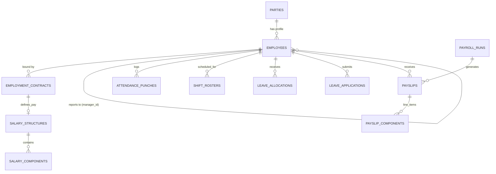

# Benchmark Analysis & Technical Specification: HRMS, Global Payroll & Compliance

**Document Target:** `research/benchmarks/04_hrms_payroll_compliance.md`

**Classification:** Systems Architecture & Domain Specification

**Status:** Approved for Implementation Baseline

---

## 1. Employee Master & Organizational Hierarchy

The foundation of any enterprise HRMS is the unified employee master record. This structure must handle complex, multi-entity corporate structures, cross-border assignments, and flexible reporting lines while maintaining strict data privacy (PII) boundaries.

### 1.1 The Unified Party-to-Employee Model
A modern HRMS abstracts the concept of a "Person" (Party) from the "Employee" (Employment Record). A single Party can have multiple sequential or concurrent Employment Records across different subsidiaries or legal entities.

*   **Party Record:** Immutable personal identifiable information (PII) – Name, Date of Birth, National ID (SSN, Aadhaar, PAN), Gender, Contact Details, Emergency Contacts, Tax Residency.
*   **Employment Record:** Volatile contractual information – Job Title, Department, Work Location, Pay Grade, Start/End Dates, Employment Type (Full-Time, Contractor, Part-Time).

### 1.2 Multi-Entity Subsidiary & Reporting Tree Topologies
Organizations frequently operate across multiple legal entities. An employee is legally bound to a specific operating company but may report to managers in entirely different legal entities.

*   **Legal Hierarchy:** Maps an employee to their contractual employer (e.g., "Acme Corp India Pvt Ltd" vs. "Acme Corp LLC"). Drives taxation and statutory compliance.
*   **Operational Hierarchy (Reporting Lines):**
    *   **Direct Line (Solid):** The primary manager responsible for performance reviews, leave approvals, and timesheet sign-offs.
    *   **Dotted Line (Matrix):** Secondary reporting relationships for project-based or functional matrix structures.

### 1.3 Lifecycle State Machines & Document Vaults
The employee lifecycle transitions through defined states:
`DRAFT` (Onboarding) $\rightarrow$ `ACTIVE` $\rightarrow$ `PROBATION` $\rightarrow$ `NOTICE_PERIOD` $\rightarrow$ `TERMINATED` / `RESIGNED` $\rightarrow$ `ALUMNI`

*   **Compliance Document Vault:** Secure, encrypted storage for I-9s (US), W-4s (US), Form 16s (India), identity proofs, and signed employment contracts. Access is strictly governed by RBAC (Role-Based Access Control).

---

## 2. Time, Attendance & Shift Scheduling

High-throughput attendance engines must ingest raw punch data from diverse hardware and software sources, normalize it into standard time blocks, and apply complex scheduling rules to compute billable/payable hours.

### 2.1 Shift Roster Management & Topologies
*   **Fixed Shifts:** Standard operating hours (e.g., 09:00 to 17:00, Mon-Fri).
*   **Flexible Shifts:** Employees must complete a set number of hours (e.g., 8 hours) within a flexible window (e.g., 07:00 to 19:00).
*   **Split Shifts:** A single working day split into multiple non-continuous blocks (e.g., Restaurant staff: 10:00-14:00 and 18:00-22:00).
*   **Rotational Shifts:** Cyclical patterns (e.g., 4 days on, 4 days off) common in manufacturing or 24/7 support.

### 2.2 Punch Normalization & API Ingestion
Biometric devices, web clocks, and geo-fenced mobile apps generate raw timestamp events (IN/OUT). The system must:
1.  **De-duplicate:** Handle rapid consecutive punches.
2.  **Pairing:** Match an `IN` punch with the next logical `OUT` punch to create an `attendance_block`.
3.  **Missing Punch Resolution:** Trigger workflows for manager override if an `OUT` punch is missing.

### 2.3 Grace Periods, Late Penalties & Loss of Pay (LOP)
Organizations enforce rules around punctuality.
*   **Grace Period:** Allowable tardiness window (e.g., 15 minutes) before marking an employee as "Late".
*   **Penalty Rules:** Accumulating late marks can automatically trigger a half-day deduction or Loss of Pay (LOP).

**Mathematical Formulation for LOP Deduction:**
$$ \text{Per-Day Salary Rate} = \frac{\text{Monthly Base Earning}}{\text{Total Days in Month (or Standard Working Days)}} $$
$$ \text{LOP Deduction} = \text{Unexcused Absent Days} \times \text{Per-Day Salary Rate} $$

### 2.4 Overtime (OT) Multi-Rate Multipliers
Overtime hours are categorized into tiers with escalating multipliers based on local labor laws.
**Mathematical Formulation for OT Pay:**
$$ \text{OT Pay} = \sum \left( \text{OT Hours}_i \times \text{Hourly Base Rate} \times \text{Tier Multiplier}_i \right) $$
*(e.g., Standard OT multiplier = 1.5x; Sunday/Holiday OT multiplier = 2.0x)*

---

## 3. Leave Management & Accrual Engines

The Leave Engine governs the accumulation and consumption of time off, strictly enforcing organizational policies and local labor regulations.

### 3.1 Accrual Policies & Proration Algorithms
Leave balances are typically granted via automated accrual jobs.
*   **Periodic Accrual:** Monthly or bi-weekly grants (e.g., +1.25 days per month).
*   **Lump-Sum Grant:** Annual upfront allocation (e.g., 15 days on Jan 1st).
*   **Tenure-Based Stepping:** Accrual rates increase with years of service (e.g., +2 days after 3 years).

**Leave Accrual Proration for Mid-Cycle Joiners:**
$$ \text{Prorated Grant} = \text{Total Annual Grant} \times \left( \frac{\text{Days Remaining in Cycle}}{\text{Total Days in Cycle}} \right) $$

### 3.2 Carry-Forward Caps & Encashment Formulas
At the end of a leave cycle (typically calendar or financial year), unused balances are processed:
*   **Carry-Forward (Lapse):** Maximum number of days allowed to rollover to the next year. Excess days lapse.
*   **Encashment:** Converting unused leave days into monetary payout, often calculated on the Base/Basic salary component rather than Gross.

### 3.3 Sandwich Rules & Approval Hierarchies
*   **Sandwich Rule (India/Middle East common):** If an employee takes leave on Friday and Monday, the intervening weekend days (Saturday/Sunday) are automatically counted as leave days.
*   **Multi-Tier Approvals:** Routine leaves (Sick/Casual) may require only direct manager approval; extended leaves (Sabbatical/Maternity) require HR or Skip-Level approval.

---

## 4. Modular Payroll Engine & Gross-to-Net Formulation

The core payroll engine must evaluate dynamic formulas against variable inputs (attendance, overtime, bonuses) to compute net payable amounts, while generating localized statutory deductions and tax withholdings.

### 4.1 Pluggable Formula & Component Architecture
A robust payroll engine does not hardcode tax brackets. It relies on a mathematical Directed Acyclic Graph (DAG) of **Salary Components**.
*   **Earnings (+):** Basic, House Rent Allowance (HRA), Dearness Allowance (DA), Overtime, Bonus.
*   **Deductions (-):** Provident Fund (PF), Income Tax (TDS/PAYE), Social Security, Unpaid Leave (LOP), Salary Advances.

### 4.2 The Zero-Variance Net Pay Invariant
The fundamental mathematical invariant of payroll processing that must balance to the penny/subunit:

$$ \text{Net Pay} \equiv \sum \text{Gross Earnings} - \sum \text{Pre-Tax Deductions} - \sum \text{Taxes/Statutory Withholdings} - \sum \text{Post-Tax Deductions} $$

*System Guardrail:* Enforce strict non-negative net pay invariants ($Net \ge 0$). If rounding discrepancies exceed the base currency subunit, the payroll execution commit must be rejected and flagged for manual reconciliation.

### 4.3 Concrete Localization Blueprints (India vs. US)
Global EOR platforms (Deel, Rippling) utilize statutory plugins to apply local tax laws without altering the core gross-to-net calculation engine.

#### India (IN) Statutory Engine
*   **Component Structure:** Heavily structured allowances (Basic, HRA, LTA, Special Allowance) to optimize tax liabilities.
*   **Provident Fund (PF):** Employee (12% of Basic) + Employer Matching contribution, capped by statutory wage ceilings (e.g., INR 15,000 limit).
*   **Employee State Insurance (ESI):** Applicable if gross wages fall below statutory thresholds.
*   **Professional Tax (PT):** State-specific slab matrices applied monthly.
*   **Income Tax (TDS):** Projected annualized income calculated monthly, evaluated against dual tax regimes (Old vs. Section 115BAC New Regime), factoring in Section 80C/80D investment declarations.

#### United States (US) Statutory Engine
*   **Component Structure:** Simpler Gross Pay model (Hourly vs. Salaried), heavy emphasis on pre-tax vs. post-tax benefit deductions.
*   **Federal Income Tax:** Computed based on W-4 withholding certificates (filing status, dependents).
*   **FICA (Federal Insurance Contributions Act):**
    *   *Social Security:* 6.2% up to the annual wage base limit.
    *   *Medicare:* 1.45% on all earnings, plus 0.9% Additional Medicare Tax over specific threshold.
*   **State & Local Taxes (SIT/LIT):** Complex jurisdictional routing based on resident vs. work location (nexus).
*   **Benefits Withholding:** Section 125 Cafeteria Plans (Health Insurance), 401(k) pre-tax deferrals (with employer match calculations), HSA contributions.

### 4.4 Automated GL Journal Entries & Payout Generation
Post-calculation, the system generates:
*   **Bank Files:** Batch NACHA (ACH) files for the US, or standard NEFT/RTGS CSV templates for Indian banking gateways.
*   **Accounting Journals:** Aggregates departmental payroll expenses, employer tax liabilities, and accrued vacation liabilities into a balanced General Ledger journal entry.

---

## 5. Offboarding & Separation Workflows (Full & Final)

Offboarding requires a strict, auditable workflow to settle financial dues, recover company assets, and restrict access.

### 5.1 Full and Final (F&F) Settlement Calculation
The final paycheck is not a standard payroll run. It encompasses:
*   **Prorated Salary:** Earnings up to the last working day.
*   **Leave Encashment:** Payout of accrued, unused leave balances.
*   **Notice Period Buyout/Recovery:** If an employee leaves early, unserved notice days are deducted. If the employer terminates early, unserved notice is paid out.
*   **Gratuity (India/UAE):** Statutory severance based on tenure (e.g., 15 days of last drawn Basic salary for every completed year, minimum 5 years service).
*   **Bonus/Commission Proration:** Settlement of pending variable pay.

### 5.2 Asset Recovery & Exit Clearances
A dependent task DAG must be cleared before the F&F payout is released:
*   *IT Dept:* Laptop returned, access revoked.
*   *Finance:* Corporate credit cards cancelled, travel advances settled.
*   *Facilities:* ID badge and keys returned.

---

## 6. Comparative Platform Synthesis & Canonical Specification

| Capability Area | Workday HCM | Rippling | Deel (EOR/Global) | Frappe HR (ERPNext) | Zoho People | Canonical Business OS Specification |
| :--- | :--- | :--- | :--- | :--- | :--- | :--- |
| **Org Modeling & Hierarchy** | Deep, highly configurable multi-dimensional hierarchies; complex position management. | Graph-based hierarchy tied closely to IT access and identity provisioning. | Flat, global contractor/EOR entity mapping. | Tree structure using `lft` and `rgt` nested set model for organizational nodes. | Department/Designation relational mapping. | **Unified Party-Employee Model** with recursive nested set DAG for multi-entity reporting lines. |
| **Shift & Attendance** | Enterprise time tracking, robust labor union rule support. | App-based punching, geo-fencing, integrated with payroll deductions. | Basic timesheet submission (hourly contractors). | Integrated biometric punch logs, shift types, and roster generation. | Comprehensive shift scheduling, IP restriction, geo-tracking. | **Event-Driven Punch Normalization API** resolving to immutable `attendance_blocks` with automated penalty engine. |
| **Global Payroll Extensibility** | Native payroll in select countries, robust connector framework for local aggregators. | Deep localized statutory engines (US, UK, etc.) managed in-house. | Best-in-class global EOR; handles local compliance and remittances as a service. | Customizable salary structures, formula builder, localized Indian tax plugins. | Zoho Payroll integration handles specific regions (India, US, UK). | **Pluggable DAG Formula Evaluator** with distinct Statutory Rule Plugins injected at runtime. |
| **Self-Service & UX** | Heavy, enterprise-grade, often requires training. | Consumer-grade, automated workflows (IT + HR). | Streamlined for remote workers, unified dashboard for global compliance. | Form-driven, functional ERP interface. | Modular, customizable forms, good mobile app. | **Role-Based Portal** leveraging fast server-side rendered views for payslip and tax document access. |

---

## 7. Canonical Enterprise Schema & DDL Specifications

### 7.1 Entity-Relationship Model



### 7.2 Data Catalog Definitions

#### `employees`
*   **`id`** (`UUID`, PK): Global unique identifier.
*   **`party_id`** (`UUID`, NOT NULL): Foreign key to master Identity/Party record.
*   **`employee_code`** (`VARCHAR(32)`, NOT NULL): Human-readable HR identifier (e.g., `EMP-1042`).
*   **`manager_id`** (`UUID`, NULL): Self-referencing FK for reporting hierarchy.
*   **`status`** (`ENUM`, NOT NULL): `ACTIVE`, `PROBATION`, `TERMINATED`, `ON_LEAVE`.
*   **`hire_date`** (`DATE`, NOT NULL): Official joining date.
*   **`termination_date`** (`DATE`, NULL): Official exit date.

#### `attendance_punches`
*   **`id`** (`UUID`, PK): Unique punch record.
*   **`employee_id`** (`UUID`, NOT NULL): Associate employee.
*   **`punch_time`** (`TIMESTAMPTZ`, NOT NULL): Exact UTC timestamp of event.
*   **`punch_type`** (`ENUM`, NOT NULL): `IN`, `OUT`.
*   **`source`** (`VARCHAR(64)`): Device ID, Web API, Mobile App.
*   **`location_geo`** (`JSONB`): Optional GPS coordinates/IP address for geo-fencing validation.

#### `leave_applications`
*   **`id`** (`UUID`, PK): Unique request ID.
*   **`employee_id`** (`UUID`, NOT NULL): Requesting employee.
*   **`leave_type_id`** (`UUID`, NOT NULL): Type of leave (Sick, Annual, Maternity).
*   **`start_date`** / **`end_date`** (`DATE`, NOT NULL): Span of leave.
*   **`total_days`** (`NUMERIC(5,2)`, NOT NULL): Computed duration excluding holidays (if applicable).
*   **`status`** (`ENUM`, NOT NULL): `PENDING`, `APPROVED`, `REJECTED`, `CANCELLED`.

#### `salary_components`
*   **`id`** (`UUID`, PK): Component definition ID.
*   **`name`** (`VARCHAR(128)`, NOT NULL): e.g., "Basic Pay", "PF Deduction".
*   **`type`** (`ENUM`, NOT NULL): `EARNING`, `DEDUCTION_PRE_TAX`, `DEDUCTION_POST_TAX`, `STATUTORY`.
*   **`formula_expression`** (`TEXT`, NULL): Evaluatable string (e.g., `base_salary * 0.40`).
*   **`is_taxable`** (`BOOLEAN`, DEFAULT `TRUE`): Flags if component is subject to income tax.

#### `payslips`
*   **`id`** (`UUID`, PK): Unique payslip ID.
*   **`payroll_run_id`** (`UUID`, NOT NULL): Batch run association.
*   **`employee_id`** (`UUID`, NOT NULL): Recipient.
*   **`period_start`** / **`period_end`** (`DATE`, NOT NULL): Pay cycle timeframe.
*   **`gross_pay`** (`NUMERIC(18,4)`, NOT NULL): Total earnings.
*   **`net_pay`** (`NUMERIC(18,4)`, NOT NULL): Final payable amount (Gross - Deductions).

### 7.3 PostgreSQL DDL Implementation

```sql
-- Schema Extension Configurations
CREATE EXTENSION IF NOT EXISTS "uuid-ossp";

-- Enumeration Definitions
CREATE TYPE employment_status AS ENUM ('DRAFT', 'ACTIVE', 'PROBATION', 'NOTICE_PERIOD', 'TERMINATED');
CREATE TYPE shift_type AS ENUM ('FIXED', 'FLEXIBLE', 'ROTATIONAL', 'SPLIT');
CREATE TYPE punch_direction AS ENUM ('IN', 'OUT');
CREATE TYPE leave_status AS ENUM ('PENDING', 'APPROVED', 'REJECTED', 'CANCELLED');
CREATE TYPE leave_balance_action AS ENUM ('ACCRUED', 'CONSUMED', 'ENCASHED', 'LAPSED');
CREATE TYPE component_type AS ENUM ('EARNING', 'DEDUCTION_PRE_TAX', 'DEDUCTION_POST_TAX', 'STATUTORY_TAX');
CREATE TYPE payroll_run_stage AS ENUM ('DRAFT', 'CALCULATING', 'REVIEW', 'COMMITTED', 'PAID');

-- ============================================================================
-- 1. EMPLOYEE MASTER
-- ============================================================================

CREATE TABLE employees (
    id UUID PRIMARY KEY DEFAULT uuid_generate_v4(),
    tenant_id UUID NOT NULL,
    party_id UUID NOT NULL,
    employee_code VARCHAR(32) NOT NULL,
    manager_id UUID REFERENCES employees(id) ON DELETE SET NULL,
    status employment_status NOT NULL DEFAULT 'DRAFT',
    hire_date DATE NOT NULL,
    termination_date DATE,
    department_id UUID,
    location_id UUID,
    created_at TIMESTAMPTZ NOT NULL DEFAULT CURRENT_TIMESTAMP,
    updated_at TIMESTAMPTZ NOT NULL DEFAULT CURRENT_TIMESTAMP,
    CONSTRAINT uq_tenant_emp_code UNIQUE(tenant_id, employee_code)
);

CREATE TABLE employment_contracts (
    id UUID PRIMARY KEY DEFAULT uuid_generate_v4(),
    tenant_id UUID NOT NULL,
    employee_id UUID NOT NULL REFERENCES employees(id) ON DELETE CASCADE,
    job_title VARCHAR(128) NOT NULL,
    contract_type VARCHAR(64) NOT NULL, -- e.g., Full-Time, Contractor
    effective_from DATE NOT NULL,
    effective_to DATE,
    base_salary NUMERIC(18, 4) NOT NULL,
    currency VARCHAR(3) NOT NULL DEFAULT 'USD',
    working_hours_per_week NUMERIC(5,2) NOT NULL DEFAULT 40.00
);

-- ============================================================================
-- 2. TIME & ATTENDANCE
-- ============================================================================

CREATE TABLE attendance_punches (
    id UUID PRIMARY KEY DEFAULT uuid_generate_v4(),
    tenant_id UUID NOT NULL,
    employee_id UUID NOT NULL REFERENCES employees(id) ON DELETE CASCADE,
    punch_time TIMESTAMPTZ NOT NULL,
    direction punch_direction NOT NULL,
    source VARCHAR(64),
    location_geo JSONB DEFAULT '{}'::jsonb,
    is_manual_override BOOLEAN DEFAULT FALSE
);
-- High-performance index for querying daily punches efficiently
CREATE INDEX idx_attendance_employee_time ON attendance_punches(employee_id, punch_time);

-- ============================================================================
-- 3. LEAVE MANAGEMENT
-- ============================================================================

CREATE TABLE leave_applications (
    id UUID PRIMARY KEY DEFAULT uuid_generate_v4(),
    tenant_id UUID NOT NULL,
    employee_id UUID NOT NULL REFERENCES employees(id) ON DELETE CASCADE,
    leave_type_id UUID NOT NULL,
    start_date DATE NOT NULL,
    end_date DATE NOT NULL,
    total_days NUMERIC(5, 2) NOT NULL,
    status leave_status NOT NULL DEFAULT 'PENDING',
    reason TEXT,
    approved_by UUID REFERENCES employees(id),
    created_at TIMESTAMPTZ NOT NULL DEFAULT CURRENT_TIMESTAMP,
    CONSTRAINT chk_valid_date_range CHECK (end_date >= start_date),
    CONSTRAINT chk_positive_days CHECK (total_days > 0)
);

CREATE TABLE leave_ledger (
    id UUID PRIMARY KEY DEFAULT uuid_generate_v4(),
    tenant_id UUID NOT NULL,
    employee_id UUID NOT NULL REFERENCES employees(id) ON DELETE CASCADE,
    leave_type_id UUID NOT NULL,
    transaction_date DATE NOT NULL,
    action leave_balance_action NOT NULL,
    days NUMERIC(5,2) NOT NULL,
    reference_id UUID, -- Links to leave_application_id or accrual_job_id
    remarks TEXT
);

-- ============================================================================
-- 4. PAYROLL ENGINE
-- ============================================================================

CREATE TABLE salary_components (
    id UUID PRIMARY KEY DEFAULT uuid_generate_v4(),
    tenant_id UUID NOT NULL,
    code VARCHAR(32) NOT NULL,
    name VARCHAR(128) NOT NULL,
    type component_type NOT NULL,
    is_taxable BOOLEAN NOT NULL DEFAULT TRUE,
    formula_expression TEXT,
    depends_on JSONB DEFAULT '[]'::jsonb, -- Array of component codes this depends on
    CONSTRAINT uq_tenant_comp_code UNIQUE(tenant_id, code)
);

CREATE TABLE salary_structures (
    id UUID PRIMARY KEY DEFAULT uuid_generate_v4(),
    tenant_id UUID NOT NULL,
    contract_id UUID NOT NULL REFERENCES employment_contracts(id) ON DELETE CASCADE,
    component_id UUID NOT NULL REFERENCES salary_components(id),
    fixed_amount NUMERIC(18, 4),
    effective_from DATE NOT NULL,
    effective_to DATE
);

CREATE TABLE payroll_runs (
    id UUID PRIMARY KEY DEFAULT uuid_generate_v4(),
    tenant_id UUID NOT NULL,
    period_start DATE NOT NULL,
    period_end DATE NOT NULL,
    stage payroll_run_stage NOT NULL DEFAULT 'DRAFT',
    processed_by UUID,
    committed_at TIMESTAMPTZ
);
CREATE INDEX idx_payroll_run_period ON payroll_runs(tenant_id, period_start, period_end);

CREATE TABLE payslips (
    id UUID PRIMARY KEY DEFAULT uuid_generate_v4(),
    tenant_id UUID NOT NULL,
    payroll_run_id UUID NOT NULL REFERENCES payroll_runs(id) ON DELETE CASCADE,
    employee_id UUID NOT NULL REFERENCES employees(id) ON DELETE RESTRICT,
    gross_pay NUMERIC(18, 4) NOT NULL DEFAULT 0.0000,
    total_deductions NUMERIC(18, 4) NOT NULL DEFAULT 0.0000,
    net_pay NUMERIC(18, 4) NOT NULL DEFAULT 0.0000,
    CONSTRAINT chk_non_negative_net CHECK (net_pay >= 0.0000),
    CONSTRAINT uq_run_employee UNIQUE(payroll_run_id, employee_id)
);

CREATE TABLE payslip_components (
    id UUID PRIMARY KEY DEFAULT uuid_generate_v4(),
    payslip_id UUID NOT NULL REFERENCES payslips(id) ON DELETE CASCADE,
    component_id UUID NOT NULL REFERENCES salary_components(id),
    amount NUMERIC(18, 4) NOT NULL,
    component_type component_type NOT NULL -- Denormalized for fast aggregation
);
-- High-performance index for component aggregations
CREATE INDEX idx_payslip_components_agg ON payslip_components(payslip_id, component_type);
```
