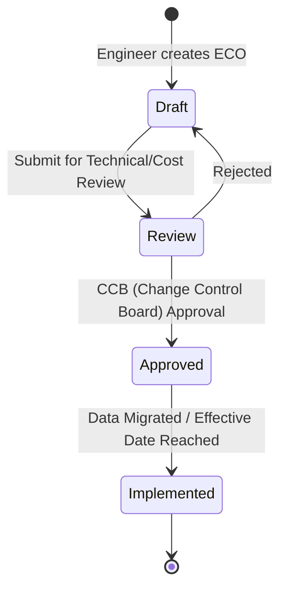
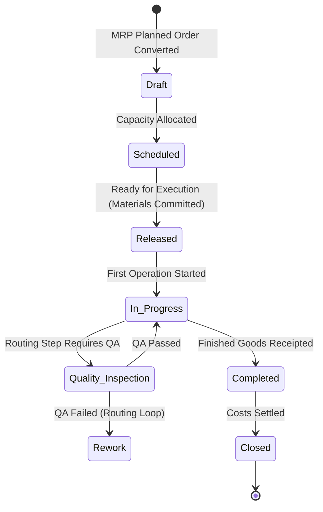
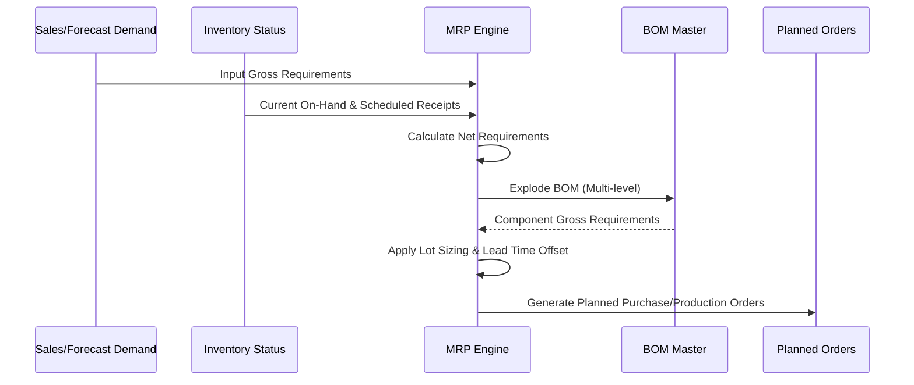

# Manufacturing, MRP & Production Lifecycle Architecture

## 1. Engineering Master Data & Product Lifecycle Management (PLM)

At the core of any manufacturing execution system is the Engineering Master. This dictates *what* is built, *how* it is built, and the evolutionary lineage of those definitions.

### Multi-level Bill of Materials (BOM)
A BOM is a hierarchical, directed graph representing the components, raw materials, and sub-assemblies required to manufacture a finished good.
- **Standard BOM:** Standard hierarchical structure.
- **Phantom / Pseudo BOM:** Logical groupings of components that are not physically built or stocked as a sub-assembly, but are useful for engineering categorization. During MRP explosion, phantoms are bypassed, and their components are elevated to the parent level.
- **Variant / Configurable BOM:** A super-BOM containing all possible variations of a product. Selection parameters (rules) determine the specific component configuration (e.g., SAP Variant Configuration).
- **Co-Products & By-Products:** Co-products are secondary goods generated alongside the primary product, holding significant value and requiring cost apportionment. By-products are incidental yields, typically possessing minor value, often deducted from the primary product's cost.

### Shrinkage and Scrap
Variances in material consumption must be deterministically modeled.
- **Component Scrap / Shrinkage ($S_{\text{component}}$):** The expected loss percentage of a specific component during assembly (e.g., 2% of bolts drop and are lost).
- **Routing/Assembly Scrap ($S_{\text{routing}}$):** The percentage of the finished assembly expected to fail quality control at a specific routing operation.

### Mathematical Constraint: Exploded Multi-Level BOM Demand
To calculate the total gross demand ($D_{\text{comp}}$) for a component given the gross demand of the parent assembly ($D_{\text{parent}}$), component quantity per parent ($Q$), component scrap, and routing scrap:

$$ D_{\text{comp}} = \frac{D_{\text{parent}} \times Q}{(1 - S_{\text{component}}) \times (1 - S_{\text{routing}})} $$

*Note: In deeply nested multi-level BOMs, this explosion compounds multiplicatively down the tree.*

### Engineering Change Order (ECO/ECN) Lifecycle
Managing revisions ensures production runs against validated, safe engineering designs.

## 2. Work Centers & Routing Operations

Routings define the chronological sequence of operations required to transform BOM components into the finished good.

### Work Centers
Work centers are logical locations where operations occur. They define capacity, cost rates, and resource availability.
- **Machine Capacity:** Available active hours for a machine.
- **Labor Pools:** Available man-hours for operators.
- **Efficiency Coefficients:** Modifiers to standard capacity based on historical performance.

### Cost Components & Time
Every operation accrues cost based on time spent.
- **Setup Time:** Fixed time to prepare the work center for a specific operation, irrespective of batch size.
- **Run Time:** Variable time to produce one unit or a base quantity.
- **Teardown Time:** Fixed time to clean/reset the work center post-operation.
- **Queue / Transit Time:** Non-value-add time waiting for the work center or moving to the next.

### Mathematical Constraint: Work Center Operation Lead Time
The total time ($T_{\text{op}}$) required for a specific operation producing a batch quantity ($Q_{\text{batch}}$):

$$ T_{\text{op}} = T_{\text{setup}} + \left( \frac{Q_{\text{batch}} \times T_{\text{run\_per\_unit}}}{\eta_{\text{efficiency}} \times \mu_{\text{utilization}}} \right) + T_{\text{teardown}} + T_{\text{transit}} $$

Where $\eta_{\text{efficiency}}$ is the work center efficiency coefficient and $\mu_{\text{utilization}}$ is the capacity utilization rate.

## 3. Production Orders & Shop-Floor Execution (MES)

The Manufacturing Execution System (MES) bridges planning and the physical shop floor.

### Work Order Lifecycle
The state machine governing a production run.

### Material Issuance Models
- **Manual Issue / Job Cards:** Operators explicitly scan/pick components against the work order. Ensures high inventory accuracy.
- **Backflushing:** Components are automatically deducted from inventory based on the theoretical BOM quantities when the finished good is receipted. Prone to variance if physical consumption deviates from the BOM without correction.

## 4. Material Requirements Planning (MRP I & MRP II) Algorithms

MRP is the deterministic algorithm that calculates *what* is needed, *how much* is needed, and *when* it is needed.

### MRP Run Logic

### Mathematical Constraint: MRP Time-Phased Net Requirement Formula
The net requirement ($N_t$) for a given period $t$:

$$ N_t = \max\left(0, \; G_t + \text{Safety Stock} - I_{t-1} - \sum \text{Scheduled Receipts}_t\right) $$

Where:
- $G_t$ = Gross Requirements in period $t$
- $I_{t-1}$ = Projected available inventory at the end of period $t-1$

### Lot-Sizing Heuristics
- **Lot-for-Lot (L4L):** Order exactly the net requirement quantity. Minimizes holding cost, maximizes setup/ordering cost.
- **Economic Order Quantity (EOQ):** Balances ordering cost against holding cost.
- **Period Order Quantity (POQ):** Aggregates net requirements across a specific dynamic time window (e.g., EOQ divided by average weekly demand).

### Mathematical Constraint: Economic Order Quantity (EOQ)
To determine the optimal fixed lot size ($Q^*$):

$$ Q^* = \sqrt{ \frac{2 \times D \times S}{H} } $$

Where:
- $D$ = Annual demand quantity
- $S$ = Fixed cost per order/setup
- $H$ = Annual holding/carrying cost per unit

## 5. Comparative Platform Matrix

| Feature Domain | SAP PP (Production Planning) | Plex Systems (Smart Mfg) | Katana Cloud Mfg | Odoo MRP / PLM |
| :--- | :--- | :--- | :--- | :--- |
| **Target Market** | Large Enterprise / Process & Discrete | Mid-Market to Enterprise / Automotive & Discrete | SMB / D2C & Light Assembly | SMB to Mid-Market / Discrete & Mixed |
| **Data Granularity** | Exceptionally high. Deep master data requirements (MM/PP integration). | High. Native MES built from shop floor up. | Moderate. Visual, intuitive, but lacks deep multi-site complexity. | Moderate to High. Highly customizable via Python/PostgreSQL. |
| **Scheduling Power** | Advanced Planning & Optimization (APO) / PP-DS. Heuristics & genetic algorithms. | Infinite and Finite capacity scheduling tightly coupled with MES. | Visual drag-and-drop. Basic finite capacity rules. | Master Production Schedule (MPS) with work center capacity rules. |
| **Shop-Floor UX** | Historically heavy (SAP GUI), improving with Fiori apps. | Excellent. Designed for rugged tablets and barcode scanners natively. | Excellent. Modern web UI tailored for quick operator adoption. | Good. Tablet-friendly shop floor application with barcode support. |
| **MES Integration** | Deep native integration via SAP MII/ME. Complex setup. | Native core architecture. ERP is built *around* the MES. | Basic tracking. Relies on integrations for heavy machine telemetry. | Native IoT box integration and shop floor control panels. |

## 6. Canonical Business OS Manufacturing Engine Specification

A best-of-breed schema design synthesizing principles from leading platforms.

### Core Data Schemas

**`mfg_bom_headers`**
- `bom_id` (UUID, PK)
- `item_id` (UUID, FK -> items)
- `version` (String)
- `is_active` (Boolean)
- `base_quantity` (Decimal)

**`mfg_bom_lines`**
- `line_id` (UUID, PK)
- `bom_id` (UUID, FK -> mfg_bom_headers)
- `component_item_id` (UUID, FK -> items)
- `quantity` (Decimal)
- `scrap_percentage` (Decimal)
- `is_phantom` (Boolean)

**`mfg_routings`**
- `routing_id` (UUID, PK)
- `bom_id` (UUID, FK -> mfg_bom_headers)

**`mfg_routing_operations`**
- `operation_id` (UUID, PK)
- `routing_id` (UUID, FK -> mfg_routings)
- `work_center_id` (UUID, FK -> mfg_work_centers)
- `sequence_order` (Integer)
- `setup_time_mins` (Decimal)
- `run_time_mins_per_unit` (Decimal)

**`mfg_work_orders`**
- `work_order_id` (UUID, PK)
- `item_id` (UUID, FK -> items)
- `bom_id` (UUID, FK -> mfg_bom_headers)
- `status` (Enum: Draft, Scheduled, Released, InProgress, QualityInspection, Rework, Completed, Closed)
- `target_quantity` (Decimal)
- `completed_quantity` (Decimal)

### Non-Negotiable Invariants & Validation Rules

1. **Acyclic BOM Graph Invariant:**
   - **Rule:** Strict graph traversal validation must occur on BOM save/activation ensuring no cyclic dependencies exist in multi-level BOMs (e.g., Component A cannot depend on Sub-Assembly B if B contains A).
   - **Enforcement:** Recursive CTE or Tarjan's algorithm execution on `mfg_bom_lines` before committing a transaction that modifies BOM structure.

2. **Work Order Backflush Integrity:**
   - **Rule:** Backflushed inventory consumption must validate against real-time physical lot/serial tracking and enforce a strict non-negative inventory rule unless explicit supervisor override flags are present.
   - **Enforcement:** Transactional block during Work Order Completion. If computed theoretical consumption $>$ physical on-hand, rollback completion and trigger discrepancy exception.

3. **Cost Absorption Invariant:**
   - **Rule:** The capitalized cost of Finished Goods ($FG_{\text{cost}}$) must strictly equal the sum of inputs and variances.
   - **Constraint:**
     $$ FG_{\text{cost}} = \sum \text{Raw Material Actual Consumption} + \sum \text{Direct Labor Applied} + \sum \text{Machine Overhead Applied} + \text{Scrap Variance} $$
   - **Enforcement:** Financial settlement layer during Work Order Closure must balance the WIP (Work In Progress) clearing accounts to zero.

### Event Interfaces

- `WorkOrderReleasedEvent(work_order_id)`: Triggers inventory hard allocations.
- `OperationCompletedEvent(operation_id, quantity, scrap, time_spent)`: Increments WIP value, updates scheduling queues.
- `MaterialIssuedEvent(work_order_id, item_id, quantity, lot_id)`: Deducts raw material inventory, credits WIP material account.
- `FinishedGoodReceiptedEvent(work_order_id, item_id, quantity, location_id)`: Debits finished goods inventory, credits WIP output.
