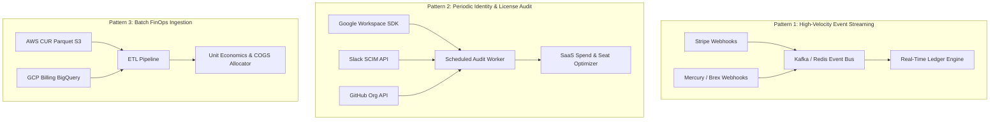

# Tech Startup 3rd-Party Tool Landscape & Integration Architecture
## Comprehensive Taxonomy, API Feasibility & SaaS Spend Optimization

---

## 1. Executive Manifesto: The Modern Startup Tech Stack Problem

The average venture-backed tech startup (15 to 100 employees) does not run on a single monolithic system. Instead, it operates across a highly fragmented web of **40 to 80 specialized SaaS applications**, spending between **$15,000 and $60,000 every single month**.

Legacy ERPs like Zoho Books, QuickBooks, and Odoo fail to capture tech startups because:
1. **Dumb Accounting Line Items:** Legacy systems treat an AWS or Figma bill as a simple debit expense. They cannot see whether 50% of the purchased seats are idle, whether ex-employees still have active access, or whether compute costs are burning margin.
2. **Disconnected Operational Reality:** In modern startups, work happens in Slack and GitHub, cash resides in Mercury or Brex, revenue processes via Stripe, and international engineers are hired via Deel. Forcing a tech team to log into an archaic ERP web portal results in immediate abandonment.
3. **The Consolidation Opportunity:** Startups do not want to buy an ERP that adds another silo. They want an AI-native ERP that **natively replaces 5-8 fragmented tools** while **autonomously monitoring, optimizing, and auditing the rest**.

---

## 2. Exhaustive Startup 3rd-Party Tool Taxonomy

```
                                  STARTUP 3RD-PARTY STACK
┌─────────────────────────────────┬─────────────────────────────────┬─────────────────────────────────┐
│       TIER 1: P0 CRITICAL       │        TIER 2: P1 CORE          │       TIER 3: P2 EXPEDIENT      │
├─────────────────────────────────┼─────────────────────────────────┼─────────────────────────────────┤
│ • Google Workspace (Email/SSO)  │ • 1Password (Vault / Shadow IT) │ • Microsoft 365 (Enterprise)    │
│ • Slack (Team Communication)    │ • Okta / JumpCloud (IdP)        │ • Cloudflare (CDN / Edge)       │
│ • Mercury (US Startup Bank)     │ • Wise (Cross-Border Remittance)│ • PostHog / Mixpanel (Analytics)│
│ • Brex / Ramp (Corporate Cards) │ • Karbon / EnKash (India Cards) │ • Sentry / Postman (Dev Ops)    │
│ • RazorpayX (India Bank / Payout)│ • Paddle / Lemon Squeezy (MoR)  │ • Zendesk / Front (Support)     │
│ • Stripe (Global Billing / CC)  │ • Chargebee (Usage Contracts)   │ • Linear / Jira (Issue Trackers)│
│ • AWS & GCP (Cloud Compute)     │ • Datadog (Observability)       │ • Pulley / Carta (Cap Tables)   │
│ • OpenAI / Anthropic (LLM APIs) │ • HubSpot (CRM & Pipeline)      │                                 │
│ • GitHub (Code & CI/CD Org)     │ • Apollo.io (Sales Prospecting) │                                 │
│ • Figma (Product Design)        │ • Intercom (Customer Support)   │                                 │
│ • Deel / Remote (Global EOR)    │ • Notion / Coda (Team Wiki)     │                                 │
└─────────────────────────────────┴─────────────────────────────────┴─────────────────────────────────┘
```

---

### Category 1: Identity, Collaboration & SaaS License Management
* **Google Workspace (P0):** Admin SDK Directory & Reports APIs. Tracks last login timestamps, email aliases, suspended status, and license SKU tiers (Business Starter vs. Plus vs. Enterprise).
* **Slack (P0):** SCIM & Audit Logs API. Tracks active workspace members, billable seat counts, guest account expirations, and channel activity.
* **GitHub (P0):** Organization API & Audit Log API. Audits \$21/user/mo Enterprise Cloud seats against actual Git commit activity in the trailing 60 days.
* **Figma (P0):** Figma REST API. Identifies automatic upgrade triggers from free "Viewers" to \$45/mo "Full Design Editors" to prevent surprise billing spikes.
* **1Password (P1):** Business API. Discovers "Shadow IT" by analyzing newly created employee credentials for unauthorized SaaS platforms.

---

### Category 2: Modern Banking, Corporate Cards & Global Treasury
* **Mercury (P0):** REST API with real-time webhooks for incoming/outgoing ACH, wire transfers, and account balance snapshots. Crucial for real-time runway forecasting.
* **Brex & Ramp (P0):** Spend Management APIs. Enables programmatic virtual card issuance with hard spending caps per vendor (e.g., "Figma Virtual Card: Capped at \$300/mo") to prevent unannounced auto-renewals.
* **RazorpayX (P0 - India):** Payouts API & Corporate Expense Cards. Automates domestic vendor bank transfers, statutory tax challans (TDS), and GST invoice capture for card swipes.
* **Wise (P1):** Multi-currency borderless account API. Tracks real-time FX conversions, intercompany wire settlements, and low-cost contractor payouts.

---

### Category 3: Cloud Infrastructure, AI Foundation Models & FinOps
* **Amazon Web Services (P0):** Cost & Usage Reports (CUR) ingested via S3 Parquet. Tracks hourly EC2, RDS, and S3 costs; flags compute runaway anomalies (>25% day-over-day surge).
* **Google Cloud Platform (P0):** Cloud Billing BigQuery Export. Real-time streaming of GCP resource consumption, GKE cluster costs, and Vertex AI spend.
* **OpenAI & Anthropic APIs (P0):** Organization Usage & Cost APIs. Breaks down token consumption by internal API key to calculate real-time Gross Margin per customer.
* **Datadog (P1):** Usage Attribution API. Monitors metric and log volume ingestion to alert engineering leads before plan overage thresholds trigger.

---

### Category 4: Payments, Subscription Billing & Revenue Engines
* **Stripe (P0):** Webhook infrastructure (`customer.subscription.created`, `invoice.payment_succeeded`, `charge.refunded`). Real-time ingestion into deferred revenue schedules (ASC 606).
* **Razorpay (P0 - India):** Payment Gateway webhook stream for domestic subscription orders, NetBanking, and UPI auto-debits.
* **Paddle / Lemon Squeezy (P1):** Merchant of Record (MoR) payout reports. Disentangles global sales tax, VAT, and MoR processing fees from net revenue.
* **Chargebee / Maxio (P1):** Complex multi-tier B2B contract synchronization, milestone billing, and metered overage tracking.

---

### Category 5: Global Human Capital, Contractors & Cap Table
* **Deel & Remote (P0):** Ingests international contractor invoices, automated compliance document verification (W-8BEN), and multi-currency payroll disbursements.
* **Carta & Pulley (P1):** Equity APIs. Synchronizes option grant milestones and option exercise events with the internal payroll tax withholding engine.

---

## 3. The 3 Technical Integration Patterns



---

## 4. Evaluation Framework for Each 3rd-Party Integration

Every tool evaluated by our research bots must satisfy four technical criteria:
1. **API Openness & Auth Standards:** Does the tool support OAuth 2.0, SCIM, and Webhooks, or does it require brittle screen-scraping?
2. **Cost-Saving ROI:** Can the integration directly save the startup quantifiable dollars (killing zombie seats, avoiding overage penalties)?
3. **Data Freshness / Latency:** Does the integration update in real-time (<5 seconds for banking/payments) or batch (daily for cloud billing)?
4. **Maintenance Overhead:** Does the provider maintain stable, versioned REST/GraphQL APIs with documented backward compatibility?
