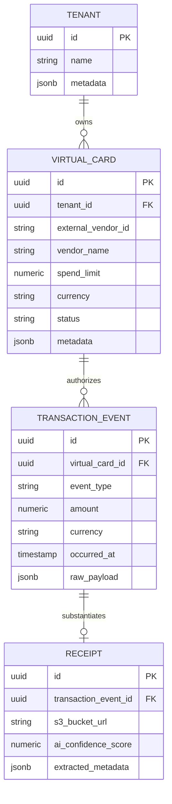

# Architectural Blueprint: Banking APIs & Real-Time Spend Control

**Target Audience**: Principal Software Architects, Staff Platform PMs
**Scope**: Benchmarking Mercury, Brex, and RazorpayX APIs for Real-Time Spend Control, Virtual Cards, and Receipt Reconciliation.

## 1. Executive Summary & Design Philosophy
This document evaluates the architectural primitives of leading banking APIs (Mercury, Brex, RazorpayX) to establish integration standards for the AI-Native Business OS. We adhere to a **Capability-First** benchmark structure, prioritizing strict isolation boundaries, deterministic state machines, idempotency, and non-destructive extensibility over vendor-specific narratives.

The objective is to establish an asynchronous, metadata-first integration architecture that guarantees mathematical balance parity using our Automated Dry-Run Reconciliation Engines, bypassing the risks of direct in-process monkey-patching or big-bang ledger cutovers.

## 2. Operational Invariants & Mathematical Models

To maintain ledger fidelity during real-time spend control and asynchronous clearing, our system strictly enforces the following mathematical invariants:

### 2.1 Real-Time Authorization Invariant
For any incoming authorization request $\mathcal{A}$ on a virtual card, the transaction is only approved if it satisfies:

$$ \mathcal{A} \leq \min(B_{t}, L_{card}) - \epsilon $$

Where:
- $B_{t}$ is the aggregate tenant cleared balance at time $t$.
- $L_{card}$ is the assigned temporal spend limit for the virtual card.
- $\epsilon$ is a calculated buffer for currency fluctuation and cross-border interchange variance.

### 2.2 Balance Parity & Reconciliation
The internal shadow ledger must perfectly reconcile with the external banking vendor's state. The Automated Dry-Run Reconciliation Engine mathematically verifies this parity before promoting state changes to the production ledger:

$$ B_{internal}(t) = B_{vendor}(0) + \sum_{i=1}^{t} ( \mathcal{D}_i - \mathcal{C}_i ) $$

Where $\mathcal{D}_i$ are settled deposits and $\mathcal{C}_i$ are settled credits (withdrawals).

## 3. Webhook Architectures & Asynchronous Event Processing

Real-time spend control demands sub-second latency and rigorous idempotency to handle network partitions and duplicate vendor webhooks.

| Capability | Mercury | Brex | RazorpayX | Architectural Recommendation |
| :--- | :--- | :--- | :--- | :--- |
| **Idempotency** | Standard `Idempotency-Key` headers | Required on all POST mutations | High-granularity payload hashes | Mandate UUID v7 idempotency keys mapped to pgvector temporal tables. |
| **Event Versioning** | Loose JSON payloads | Strict versioning via headers | Versioned domain events | Use decoupled asynchronous inter-app messaging via Kafka/RabbitMQ. No direct API binding. |
| **Webhook Retry Policy** | Exponential backoff (up to 72h) | Fixed interval (up to 24h) | Granular webhook routing | Implement a Dead Letter Queue (DLQ) with circuit breakers for failed state transitions. |
| **Latency Guarantees** | P95 ~800ms | P95 ~1200ms | P95 ~600ms | Cache virtual card limits in Redis to intercept pre-authorizations within 200ms. |

### 3.1 JSON Schema Contract: Webhook Intercept (TypeScript)

```typescript
export interface WebhookEvent<T = Record<string, unknown>> {
  eventId: string; // UUID v7
  vendor: 'MERCURY' | 'BREX' | 'RAZORPAYX';
  eventType: 'transaction.authorized' | 'transaction.cleared' | 'card.issued';
  timestamp: string; // ISO8601
  payload: T;
  signature: string; // HMAC-SHA256
  metadata: Record<string, any>; // Extensibility via JSONB
}
```

## 4. Vendor-Locked Virtual Card Models & Issuing Primitives

Virtual cards are the primary enforcement mechanism for proactive spend control. The architectural risk lies in vendor lock-in regarding card metadata and lifecycle management.

| Capability | Mercury | Brex | RazorpayX | Architectural Recommendation |
| :--- | :--- | :--- | :--- | :--- |
| **Limit Enforcement** | Daily/Monthly limits, weak real-time | Dynamic API-driven limits | Real-time API interventions | Abstract card objects into a canonical internal `VirtualCard` entity. |
| **Vendor Coupling** | High (Dashboard dependent) | Very High (Expense management integrated) | Medium (API-first decoupled) | Store customizations in metadata via JSONB/EAV namespaces. Zero hard-coded forks. |
| **Issuing Speed** | Synchronous | Asynchronous | Synchronous | Map external card IDs to internal UUIDs via decoupled relational references. |

## 5. Receipt Matching Workflows & AI Metadata Reconciliation

Receipt matching involves asynchronous extraction, OCR via Vision-Language Models, and metadata reconciliation against settled transactions.

The AI operations within the core system strictly follow a 3-tier confidence model:
- **Tier 1 (Autonomous Execution):** $\ge 98\%$ confidence + mathematical invariant pass. Automatically reconciles receipt total $\mathcal{T}_{receipt}$ with transaction authorization $\mathcal{A}$.
- **Tier 2 (Assisted / One-Click Approval):** $85\% - 97\%$ confidence. Requires Manager approval via UI slots.
- **Tier 3 (Quarantined / Human Investigation):** $< 85\%$ confidence or anomalous patterns. Routed to manual audit queue.

| Capability | Mercury | Brex | RazorpayX | Architectural Recommendation |
| :--- | :--- | :--- | :--- | :--- |
| **OCR Quality** | N/A (Relies on external tools) | Embedded, high accuracy | Limited to basic invoices | Route raw images to commercial/open-weight Vision-Language Models. |
| **Matching Logic** | Manual upload | Auto-matching via time/amount heuristics | Vendor API | Internal AI engine using pgvector embeddings for probabilistic matching. |

## 6. Technical Specification

### 6.1 Mermaid.js Entity-Relationship (ER) Diagram



### 6.2 Data Catalog Tables

| Entity | Attribute | Data Type | Constraint | Description |
| :--- | :--- | :--- | :--- | :--- |
| `tenant` | `id` | UUID | PK | Canonical tenant identifier. |
| `tenant` | `metadata` | JSONB | - | Extensibility namespace for tenant configs. |
| `virtual_card` | `external_vendor_id`| VARCHAR | UNIQUE | The card ID issued by Brex/Mercury/RazorpayX. |
| `transaction_event`| `amount` | NUMERIC(19,4)| NOT NULL | Exact transaction amount supporting 4 decimal places. |
| `receipt` | `ai_confidence_score`| NUMERIC(5,4) | $0 \le x \le 1$ | 3-tier confidence model threshold enforcer. |

### 6.3 Production-Ready PostgreSQL DDL

```sql
-- Schema for Integration Core
CREATE SCHEMA IF NOT EXISTS banking_integrations;

-- Tenant Core
CREATE TABLE banking_integrations.tenant (
    id UUID PRIMARY KEY DEFAULT gen_random_uuid(),
    name VARCHAR(255) NOT NULL,
    metadata JSONB DEFAULT '{}'::jsonb,
    created_at TIMESTAMP WITH TIME ZONE DEFAULT CURRENT_TIMESTAMP
);

-- Virtual Card Abstraction
CREATE TABLE banking_integrations.virtual_card (
    id UUID PRIMARY KEY DEFAULT gen_random_uuid(),
    tenant_id UUID NOT NULL,
    external_vendor_id VARCHAR(255) NOT NULL,
    vendor_name VARCHAR(50) NOT NULL,
    spend_limit NUMERIC(19,4) NOT NULL DEFAULT 0.0000,
    currency VARCHAR(3) NOT NULL DEFAULT 'USD',
    status VARCHAR(50) NOT NULL DEFAULT 'ACTIVE',
    metadata JSONB DEFAULT '{}'::jsonb,
    created_at TIMESTAMP WITH TIME ZONE DEFAULT CURRENT_TIMESTAMP,
    CONSTRAINT fk_virtual_card_tenant FOREIGN KEY (tenant_id) REFERENCES banking_integrations.tenant (id) ON DELETE CASCADE
);

-- Explicit Index for Foreign Key
CREATE INDEX idx_virtual_card_tenant_id ON banking_integrations.virtual_card (tenant_id);
CREATE UNIQUE INDEX idx_virtual_card_external_id ON banking_integrations.virtual_card (external_vendor_id, vendor_name);

-- Transaction Webhook Events (Append-Only Log)
CREATE TABLE banking_integrations.transaction_event (
    id UUID PRIMARY KEY DEFAULT gen_random_uuid(),
    virtual_card_id UUID NOT NULL,
    event_type VARCHAR(100) NOT NULL,
    amount NUMERIC(19,4) NOT NULL,
    currency VARCHAR(3) NOT NULL DEFAULT 'USD',
    occurred_at TIMESTAMP WITH TIME ZONE NOT NULL,
    raw_payload JSONB NOT NULL,
    processed_at TIMESTAMP WITH TIME ZONE,
    CONSTRAINT fk_transaction_virtual_card FOREIGN KEY (virtual_card_id) REFERENCES banking_integrations.virtual_card (id)
);

-- Explicit Index for Foreign Key
CREATE INDEX idx_transaction_event_card_id ON banking_integrations.transaction_event (virtual_card_id);
CREATE INDEX idx_transaction_event_occurred_at ON banking_integrations.transaction_event (occurred_at);

-- Receipt AI Reconciliation
CREATE TABLE banking_integrations.receipt (
    id UUID PRIMARY KEY DEFAULT gen_random_uuid(),
    transaction_event_id UUID NOT NULL,
    s3_bucket_url TEXT NOT NULL,
    ai_confidence_score NUMERIC(5,4) NOT NULL CHECK (ai_confidence_score >= 0 AND ai_confidence_score <= 1),
    extracted_metadata JSONB DEFAULT '{}'::jsonb,
    created_at TIMESTAMP WITH TIME ZONE DEFAULT CURRENT_TIMESTAMP,
    CONSTRAINT fk_receipt_transaction FOREIGN KEY (transaction_event_id) REFERENCES banking_integrations.transaction_event (id) ON DELETE SET NULL
);

-- Explicit Index for Foreign Key
CREATE INDEX idx_receipt_transaction_event_id ON banking_integrations.receipt (transaction_event_id);
```