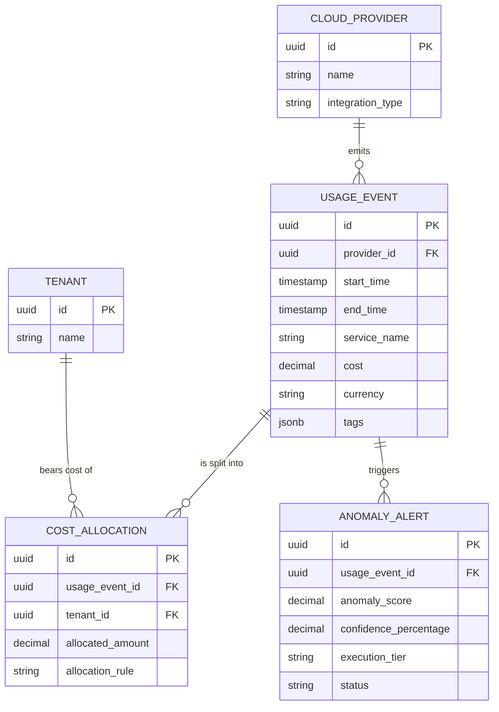

# Cloud FinOps & API Telemetry: Architectural Benchmark

## 1. High-Volume Ingestion & Canonical Normalization

### 1.1 Capability-First Analysis: Telemetry Ingestion
Managing multi-cloud cost data requires unified telemetry ingestion. Different vendors supply cost and usage data through disjointed paradigms:
*   **AWS Cost and Usage Reports (CUR)**: Emits deeply granular data into S3 (often in Parquet or GZIP CSV). It includes comprehensive resource-level details with dynamic, nested user-defined tags. The cadence is typically hourly or daily, requiring robust asynchronous batch ingestion pipelines.
*   **GCP BigQuery Billing Export**: Streams billing telemetry continuously into a BigQuery dataset. Data structures include repeated/nested arrays for labels, credits, and project metadata, necessitating unnesting operations for relational transformations.
*   **OpenAI API Usage Pipelines**: Relies on RESTful polling of usage endpoints, delivering token consumption metrics segmented by organization, project, and model. Usage is typically near-real-time but subject to API rate limits, pagination overhead, and potential latency.

### 1.2 Synthesized Canonical Blueprint
A canonical FinOps architecture must abstract the provider-specific delivery mechanisms into a unified `CloudUsageEvent` stream. This involves an idempotent ingestion layer using cursor-based pagination for APIs and event-driven triggers (e.g., S3/GCS object creation) for bulk files. Data is stored in a normalized relational schema with robust `JSONB` support to capture arbitrary tags and labels, preserving the Business OS Non-Destructive Extensibility invariant.

## 2. Customer Unit-Margin Allocation Models

### 2.1 Capability-First Analysis: Unit Economics
To compute accurate SaaS unit margins, shared cloud infrastructure (like Kubernetes clusters, egress bandwidth, or multi-tenant database clusters) and aggregated AI token usage must be allocated down to the individual B2B tenant or customer.

### 2.2 Mathematical Model & Formulas
The allocation of shared costs employs a dynamic weighting model based on telemetry proxy metrics (e.g., API calls, storage bytes, active users).

Let $T$ be the set of all tenants. For a given tenant $i \in T$, the allocated shared cost for a resource category $R$ over time period $t$ is calculated as:

$$
\text{Allocated Shared COGS}_{i, R, t} = \text{Total Shared Cost}_{R, t} \times \frac{\text{Metric}_{i, R, t}}{\sum_{j \in T} \text{Metric}_{j, R, t}}
$$

The net unit margin for tenant $i$ is then derived as:

$$
\text{Margin}_{i, t} = \text{Revenue}_{i, t} - \left( \text{Direct COGS}_{i, t} + \sum_{R} \text{Allocated Shared COGS}_{i, R, t} \right)
$$

### 2.3 Operational Invariants
1.  **Zero-Sum Allocation Invariant**: The sum of all allocated shared costs across tenants must exactly equal the total shared cost pool for that period.
    $$ \sum_{i \in T} \text{Allocated Shared COGS}_{i, R, t} = \text{Total Shared Cost}_{R, t} $$
2.  **Immutability of Billed Periods**: Once an allocation cycle is committed (hard lock), historical telemetry cannot be re-allocated without a formal void-and-reissue journal entry to prevent ledger drift.

## 3. Runaway Compute Anomaly Detection

### 3.1 Capability-First Analysis: Automated Cost Governance
Cloud environments are susceptible to runaway compute—where infinite loops, compromised API keys, or misconfigured autoscaling cause exponential cost spikes. The system employs an AI-driven anomaly detection engine evaluating near-real-time telemetry.

### 3.2 Mathematical Formulation
The detection model utilizes an Exponential Moving Average (EMA) to establish baselines and calculates a Z-score for recent consumption windows to identify anomalies deterministically.

Let $x_t$ be the cost or token usage at time interval $t$.
Let $\mu_t$ and $\sigma_t$ be the EMA mean and standard deviation of usage.

The anomaly score $Z_t$ is evaluated as:

$$
Z_t = \frac{x_t - \mu_t}{\sigma_t}
$$

### 3.3 The 3-Tier AI Confidence Model Execution
The AI detection engine evaluates the anomalous event and assigns a confidence score $C$ (where $0\% \le C \le 100\%$) indicating the likelihood of a malicious or runaway scenario. Responses are strictly governed by the architectural confidence tiers:

*   **Tier 1 (Autonomous Execution): $C \ge 98\%$**
    *   **Action**: Mathematical invariants pass (e.g., runaway velocity exceeds predefined absolute maximum limits). The system autonomously trips the circuit breaker, revoking API keys, invalidating tokens, or terminating rogue compute instances without human intervention.
*   **Tier 2 (Assisted / One-Click Approval): $85\% \le C < 98\%$**
    *   **Action**: High probability of anomaly but falls below the autonomous execution threshold. Generates a critical alert payload to FinOps controllers with a one-click "Kill Switch" or "Ignore" deterministic action payload.
*   **Tier 3 (Quarantined / Human Investigation): $C < 85\%$**
    *   **Action**: Minor anomalous pattern detected (e.g., unexpected model usage shift or moderate traffic spike) but very low confidence of a fatal runaway event. Logged to the quarantine queue for asynchronous human investigation.

## 4. Tri-Part Technical Specification

### 4.1 Entity-Relationship Architecture (Mermaid.js)



### 4.2 Data Catalog & Interface Schemas

#### Canonical Entities & Field Specifications

| Entity | Attribute | Semantic Type | Constraints | Description |
| :--- | :--- | :--- | :--- | :--- |
| **CloudProvider** | `id` | UUID | PK | Unique identifier for AWS, GCP, OpenAI |
| | `name` | VARCHAR(100) | NOT NULL | Human-readable provider name |
| **UsageEvent** | `id` | UUID | PK | Immutable ingestion event identifier |
| | `provider_id` | UUID | FK -> CloudProvider(id) | Source system reference |
| | `start_time` | TIMESTAMP | NOT NULL | Interval start bound |
| | `end_time` | TIMESTAMP | NOT NULL | Interval end bound |
| | `cost` | DECIMAL(18,6) | NOT NULL | Unallocated total cost amount |
| | `tags` | JSONB | | Extensible Key-Value pairs for resource labels |
| **CostAllocation** | `id` | UUID | PK | Resolved unit-margin cost line |
| | `usage_event_id`| UUID | FK -> UsageEvent(id) | Parent usage event linkage |
| | `tenant_id` | UUID | FK -> Tenant(id) | Target customer / tenant |
| | `allocated_amount`| DECIMAL(18,6)| NOT NULL | Exact apportioned cost |
| **AnomalyAlert** | `id` | UUID | PK | State machine payload for FinOps incidents |
| | `confidence_pct`| DECIMAL(5,2) | [0, 100] | Computed AI Confidence Score |
| | `execution_tier`| ENUM | NOT NULL | TIER_1, TIER_2, TIER_3 mappings |
| | `status` | ENUM | NOT NULL | OPEN, MITIGATED, FALSE_POSITIVE |

### 4.3 Production-Ready PostgreSQL DDL

```sql
-- Schema Definition for Cloud FinOps Engine
-- Prioritizes extensibility (JSONB), exact precision (DECIMAL), and query latency (INDEXES)

CREATE TYPE alert_tier_enum AS ENUM ('TIER_1', 'TIER_2', 'TIER_3');
CREATE TYPE alert_status_enum AS ENUM ('OPEN', 'MITIGATED', 'FALSE_POSITIVE', 'AUTO_RESOLVED');

CREATE TABLE cloud_providers (
    id UUID PRIMARY KEY DEFAULT gen_random_uuid(),
    name VARCHAR(100) NOT NULL,
    integration_type VARCHAR(50) NOT NULL,
    created_at TIMESTAMP WITH TIME ZONE DEFAULT CURRENT_TIMESTAMP
);

CREATE TABLE tenants (
    id UUID PRIMARY KEY DEFAULT gen_random_uuid(),
    name VARCHAR(255) NOT NULL,
    created_at TIMESTAMP WITH TIME ZONE DEFAULT CURRENT_TIMESTAMP
);

CREATE TABLE usage_events (
    id UUID PRIMARY KEY DEFAULT gen_random_uuid(),
    provider_id UUID NOT NULL,
    start_time TIMESTAMP WITH TIME ZONE NOT NULL,
    end_time TIMESTAMP WITH TIME ZONE NOT NULL,
    service_name VARCHAR(255) NOT NULL,
    cost DECIMAL(18,6) NOT NULL,
    currency CHAR(3) NOT NULL DEFAULT 'USD',
    tags JSONB DEFAULT '{}'::jsonb,
    ingested_at TIMESTAMP WITH TIME ZONE DEFAULT CURRENT_TIMESTAMP,
    CONSTRAINT fk_provider FOREIGN KEY (provider_id) REFERENCES cloud_providers(id)
);

-- Explicit indexes for foreign keys and query optimization
CREATE INDEX idx_usage_events_provider_id ON usage_events(provider_id);
CREATE INDEX idx_usage_events_time_range ON usage_events(start_time, end_time);
CREATE INDEX idx_usage_events_tags ON usage_events USING GIN (tags);

CREATE TABLE cost_allocations (
    id UUID PRIMARY KEY DEFAULT gen_random_uuid(),
    usage_event_id UUID NOT NULL,
    tenant_id UUID NOT NULL,
    allocated_amount DECIMAL(18,6) NOT NULL,
    allocation_rule VARCHAR(100) NOT NULL,
    created_at TIMESTAMP WITH TIME ZONE DEFAULT CURRENT_TIMESTAMP,
    CONSTRAINT fk_usage_event FOREIGN KEY (usage_event_id) REFERENCES usage_events(id),
    CONSTRAINT fk_tenant FOREIGN KEY (tenant_id) REFERENCES tenants(id)
);

-- Explicit indexes for foreign keys
CREATE INDEX idx_cost_allocations_usage_event_id ON cost_allocations(usage_event_id);
CREATE INDEX idx_cost_allocations_tenant_id ON cost_allocations(tenant_id);

CREATE TABLE anomaly_alerts (
    id UUID PRIMARY KEY DEFAULT gen_random_uuid(),
    usage_event_id UUID NOT NULL,
    anomaly_score DECIMAL(10,4) NOT NULL,
    confidence_pct DECIMAL(5,2) CHECK (confidence_pct >= 0 AND confidence_pct <= 100),
    execution_tier alert_tier_enum NOT NULL,
    status alert_status_enum NOT NULL DEFAULT 'OPEN',
    detected_at TIMESTAMP WITH TIME ZONE DEFAULT CURRENT_TIMESTAMP,
    resolved_at TIMESTAMP WITH TIME ZONE,
    CONSTRAINT fk_anomaly_usage_event FOREIGN KEY (usage_event_id) REFERENCES usage_events(id)
);

-- Explicit indexes for foreign keys and status queries
CREATE INDEX idx_anomaly_alerts_usage_event_id ON anomaly_alerts(usage_event_id);
CREATE INDEX idx_anomaly_alerts_status ON anomaly_alerts(status);
```
