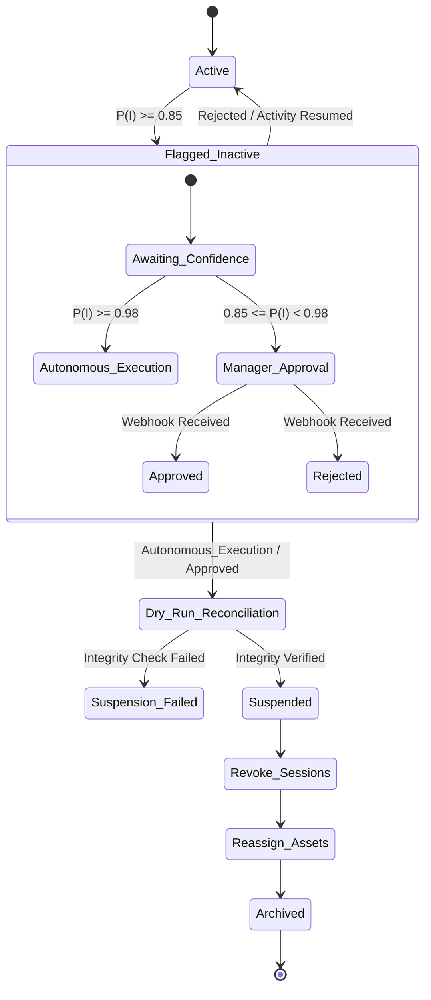

# Architectural Blueprint: Identity APIs for SaaS Seat Optimization

**Target Audience:** Principal Software Architects, Staff Platform PMs
**Domain:** Integrations, SaaS License Optimization, Identity Lifecycle Management

This document provides a rigorously structured architectural blueprint for integrating with core Identity and Collaboration APIs (Google Workspace, Slack, GitHub) to optimize SaaS seat utilization and automate offboarding.

## 1. Authorization & Access Control (OAuth Scopes)

To securely query identity states and execute offboarding, the platform must request the principle of least privilege scopes.

| Capability | Google Workspace | Slack | GitHub |
| :--- | :--- | :--- | :--- |
| **Read User Roster** | `admin.directory.user.readonly` | `users:read`, `team:read` | `read:org`, `read:user` |
| **Read Activity Logs** | `admin.reports.audit.readonly` | `admin.analytics:read` | `admin:org` |
| **Suspend/Deactivate User** | `admin.directory.user` | `admin.users:write` | `admin:org` |
| **Token Revocation/Sessions** | `admin.directory.user.security` | `admin.users:write` | `admin:org` |

## 2. Operational Resiliency (Rate Limits & Tolerances)

Deterministic integration boundaries require strict adherence to vendor rate limits. The system utilizes decoupled asynchronous message queues to respect these constraints, avoiding direct synchronous coupling.

| Capability/Metric | Google Workspace | Slack | GitHub |
| :--- | :--- | :--- | :--- |
| **Global Quota** | ~1,500 req / 100 sec / IP | Tier-based (Tier 2-4) | 5,000 req / hour (REST) |
| **Pagination Standard** | Page Token | Cursor-based (`next_cursor`) | Link Header / Relay Cursor |
| **Backoff Strategy** | Exponential (429/500/503) | HTTP 429 `Retry-After` | HTTP 429 / X-RateLimit-Reset |
| **GraphQL Support** | N/A | N/A | 5,000 points / hour |

## 3. Inactive Account Heuristics & Usage Analysis

### Mathematical Invariants for Inactivity

SaaS Seat Optimization relies on a composite decay function to calculate an Inactivity Probability Score $P(I)$. The score aggregates normalized activity vectors $\mathbf{v}$ across $N$ disparate API endpoints over a trailing $\Delta t$ window.

Let $A_{i,t}$ be the count of activity type $i$ at time $t$. The decayed activity score $S(T)$ at present time $T$ is defined as:

$$
S(T) = \sum_{i=1}^{N} w_i \sum_{t=T-\Delta t}^{T} A_{i,t} \cdot e^{-\lambda (T-t)}
$$

Where:
- $w_i$ is the business-defined weight for activity type $i$ (e.g., $w_{\text{commit}} > w_{\text{login}}$).
- $\lambda$ is the decay constant, typically $\ln(2) / t_{1/2}$ where $t_{1/2}$ is the half-life of an activity's relevance.

The probability of genuine inactivity $P(I)$ is mapped via a sigmoid function:

$$
P(I) = \frac{1}{1 + e^{k(S(T) - \theta)}}
$$

Where $\theta$ is the minimum activity threshold and $k$ is the steepness of the cutoff. Action is taken based on a 3-tier confidence model:
- **Tier 1 (Autonomous Suspension):** $P(I) \ge 0.98$ (Mathematically verified invariant pass)
- **Tier 2 (Manager Approval Required):** $0.85 \le P(I) < 0.98$
- **Tier 3 (Quarantined/Human Investigation):** $P(I) < 0.85$ (Anomalous pattern)

### Data Catalog: Canonical Activity Payload

```typescript
export interface NormalizedActivityEvent {
  /** UUID of the internal tenant */
  tenantId: string;
  /** Identity ID across the platform ecosystem */
  globalIdentityId: string;
  /** Vendor namespace (e.g., 'google_workspace', 'slack', 'github') */
  provider: string;
  /** Normalized type of activity */
  activityType: 'LOGIN' | 'MESSAGE' | 'COMMIT' | 'PR_MERGE' | 'DOCUMENT_EDIT';
  /** ISO-8601 Timestamp of the activity */
  timestamp: string;
  /** Calculated weight based on event complexity */
  weight: number;
}
```

## 4. Automated Offboarding State Machine

The offboarding lifecycle enforces an 'Opening Balances Cutover + Searchable Read-Only Archive' principle. Hard deletions are forbidden until the `Dry_Run_Reconciliation` mathematically verifies that linked financial and operational records are intact.



## 5. Persistence & State Management (PostgreSQL DDL)

The following schema defines the deterministic boundaries for identity states, provider API configurations, and the offboarding workflow state machine.

```sql
-- -----------------------------------------------------------------------------
-- DDL for SaaS Identity Management & Offboarding Workflow
-- -----------------------------------------------------------------------------

CREATE TABLE IF NOT EXISTS integration_providers (
    provider_id UUID PRIMARY KEY DEFAULT gen_random_uuid(),
    name VARCHAR(50) NOT NULL UNIQUE, -- e.g., 'google_workspace', 'slack', 'github'
    oauth_client_config JSONB NOT NULL,
    rate_limit_capacity INT NOT NULL,
    created_at TIMESTAMPTZ NOT NULL DEFAULT NOW()
);

CREATE TABLE IF NOT EXISTS tenant_identities (
    identity_id UUID PRIMARY KEY DEFAULT gen_random_uuid(),
    tenant_id UUID NOT NULL,
    provider_id UUID NOT NULL,
    provider_user_id VARCHAR(255) NOT NULL,
    email VARCHAR(255) NOT NULL,
    status VARCHAR(50) NOT NULL DEFAULT 'ACTIVE',
    last_activity_at TIMESTAMPTZ,
    inactivity_score NUMERIC(5,4) DEFAULT 0.0000,
    metadata JSONB DEFAULT '{}'::jsonb,
    created_at TIMESTAMPTZ NOT NULL DEFAULT NOW(),
    updated_at TIMESTAMPTZ NOT NULL DEFAULT NOW(),
    UNIQUE (provider_id, provider_user_id)
);

-- Explicit indexes for foreign keys and lookup performance
CREATE INDEX idx_tenant_identities_tenant_id ON tenant_identities(tenant_id);
CREATE INDEX idx_tenant_identities_provider_id ON tenant_identities(provider_id);
CREATE INDEX idx_tenant_identities_status ON tenant_identities(status);

CREATE TABLE IF NOT EXISTS offboarding_workflows (
    workflow_id UUID PRIMARY KEY DEFAULT gen_random_uuid(),
    identity_id UUID NOT NULL,
    current_state VARCHAR(50) NOT NULL DEFAULT 'FLAGGED_INACTIVE',
    confidence_tier INT NOT NULL CHECK (confidence_tier IN (1, 2, 3)),
    dry_run_passed BOOLEAN DEFAULT FALSE,
    state_history JSONB NOT NULL DEFAULT '[]'::jsonb,
    initiated_at TIMESTAMPTZ NOT NULL DEFAULT NOW(),
    completed_at TIMESTAMPTZ
);

-- Explicit indexes for foreign keys and workflow state lookups
CREATE INDEX idx_offboarding_workflows_identity_id ON offboarding_workflows(identity_id);
CREATE INDEX idx_offboarding_workflows_state ON offboarding_workflows(current_state);

-- Foreign Key Constraints
ALTER TABLE tenant_identities
    ADD CONSTRAINT fk_tenant_identities_provider
    FOREIGN KEY (provider_id) REFERENCES integration_providers(provider_id)
    ON DELETE RESTRICT;

ALTER TABLE offboarding_workflows
    ADD CONSTRAINT fk_offboarding_workflows_identity
    FOREIGN KEY (identity_id) REFERENCES tenant_identities(identity_id)
    ON DELETE RESTRICT;
```
