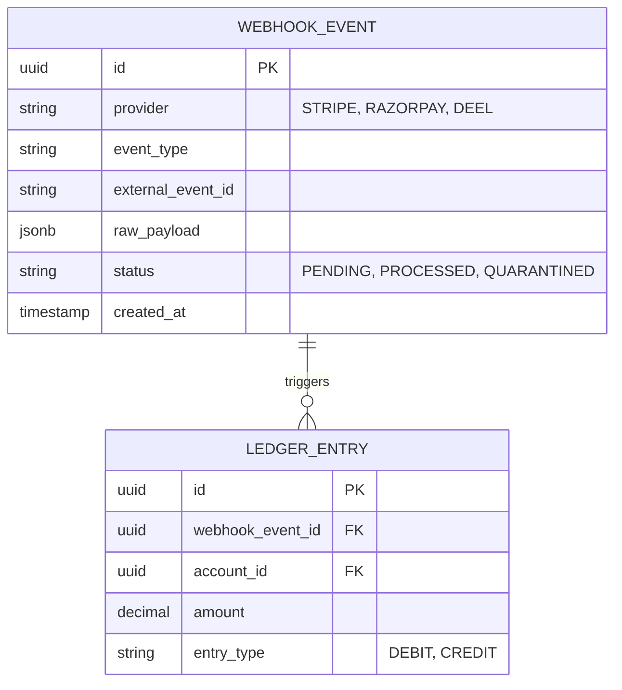
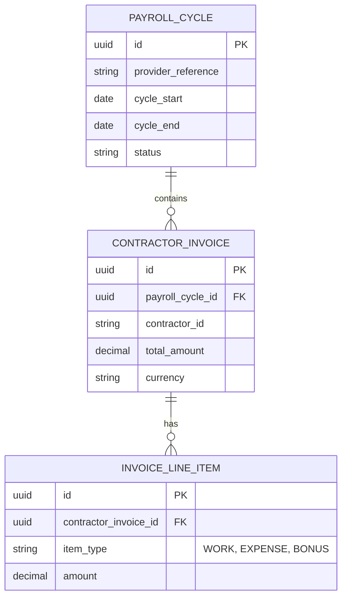

# Automated Revenue & Payroll Sync: Architecture & API Benchmark

*References: [Startup Third Party Tool Landscape](../../23_startup_third_party_tool_landscape.md) | [Jules Integration Research Tasks](../../24_jules_integration_research_tasks.md)*

This document establishes the architectural blueprints for ingesting, validating, and materializing third-party financial events into the Business OS General Ledger. It benchmarks Stripe and Razorpay (Revenue/Collections) and Deel (Contractor Payroll) under strict functional domains.


## 1. Webhook Ingestion & Idempotency State Machine

### 1.1 Comparative Matrix: Edge Ingestion & Isolation Boundaries

| Capability | Stripe | Razorpay | Deel | Platform OS Abstraction |
| :--- | :--- | :--- | :--- | :--- |
| **Event Delivery & Retry** | `Event` object with `type` and `data.object`. Exponential backoff retries for up to 3 days. | Event string type, nested `payload`. Fixed interval retries. | Webhook subscriptions for invoice creation/payment. | Canonical CloudEvents envelope over decoupled asynchronous messaging. |
| **Idempotency & Integrity** | Native `Stripe-Signature` (HMAC-SHA256) and unique `id` in event payload. | `x-razorpay-signature` and event `id`. | Secret token signature. | Global unique constraint on `(provider, external_event_id)` preventing dual-processing. |
| **Latency Guarantees** | High burst predictability; low latency. | High burst during regional peak hours. | Batch-oriented syncs (payroll cycles); high latency. | Async queue (Kafka/SQS) with strict Dead Letter Queue (DLQ) quarantines (Confidence Tier 3). |
| **Data Storage / Metadata**| Heavy nested JSON blobs with embedded context. | Shallow JSON structures. | Nested JSON arrays (items/contractors).| Isolated JSONB tenant namespaces preventing schema bloat. |

### 1.2 State Machine & Isolation Architecture (Mermaid)



### 1.3 Interface Specification (TypeScript)

```typescript
/**
 * Canonical CloudEvent envelope for ingesting any third-party financial webhook.
 * This guarantees structural immutability before persistence.
 */
export interface CanonicalWebhookEvent {
  id: string; // Internal UUID v4
  provider: 'STRIPE' | 'RAZORPAY' | 'DEEL';
  event_type: string; // e.g., 'charge.succeeded', 'payment.captured'
  external_event_id: string; // Provider's idempotency key
  payload: Record<string, any>; // Captured in JSONB
  received_at: string; // ISO8601 Timestamp
}
```

### 1.4 Production-Ready PostgreSQL DDL

```sql
CREATE TABLE webhook_events (
    id UUID PRIMARY KEY DEFAULT gen_random_uuid(),
    tenant_id UUID NOT NULL,
    provider VARCHAR(50) NOT NULL,
    event_type VARCHAR(100) NOT NULL,
    external_event_id VARCHAR(255) NOT NULL,
    raw_payload JSONB NOT NULL,
    status VARCHAR(50) NOT NULL DEFAULT 'PENDING' CHECK (status IN ('PENDING', 'PROCESSED', 'QUARANTINED', 'FAILED')),
    created_at TIMESTAMP WITH TIME ZONE DEFAULT CURRENT_TIMESTAMP
);

-- Idempotency constraint
ALTER TABLE webhook_events ADD CONSTRAINT unique_tenant_provider_event UNIQUE (tenant_id, provider, external_event_id);

-- Performance Indices
CREATE INDEX idx_webhook_events_tenant_status ON webhook_events (tenant_id, status);
CREATE INDEX idx_webhook_events_external_id ON webhook_events (external_event_id);
```

## 2. Fee Unbundling & Double-Entry Ledger Mappings

### 2.1 Capability-First Analysis

When capturing revenue via Stripe or Razorpay, the settlement amount differs from the gross charge due to deducted gateway fees. The Business OS must deterministically unbundle the gross amount to properly represent revenue, expenses, and cash-in-transit in a double-entry ledger without relying on hard-coded forks.

### 2.2 Mathematical Invariants

Let $G$ be the Gross Transaction Amount, $F$ be the Gateway Fee, and $N$ be the Net Settlement Amount.

The gateway settlement invariant strictly requires:
$$ G - F = N $$

Double-entry journal balancing constraint requires the sum of debits to exactly equal the sum of credits. For a successful charge:
$$ \sum \text{Debits} = \sum \text{Credits} $$
$$ N \text{ (Cash in Transit)} + F \text{ (Gateway Fees Expense)} = G \text{ (Accounts Receivable / Revenue)} $$

### 2.3 Data Catalog

| Entity | Attribute | Semantic Type | Constraints | Description |
| :--- | :--- | :--- | :--- | :--- |
| **Account** | `id` | UUID | PK | Target natural account |
| | `code` | VARCHAR(50) | UNIQUE(tenant_id) | Account identifier |
| | `account_type` | VARCHAR(50) | NOT NULL | ASSET, LIABILITY, REVENUE, EXPENSE |
| **LedgerEntry** | `id` | UUID | PK | Ledger line item |
| | `webhook_event_id` | UUID | FK -> webhook_events(id)| Traceability to raw event |
| | `account_id` | UUID | FK -> accounts(id) | The account affected |
| | `amount` | DECIMAL(18,4) | NOT NULL | Monetary value |
| | `entry_type` | VARCHAR(10) | IN ('DEBIT', 'CREDIT')| Accounting direction |

### 2.4 Production-Ready PostgreSQL DDL

```sql
CREATE TABLE accounts (
    id UUID PRIMARY KEY DEFAULT gen_random_uuid(),
    tenant_id UUID NOT NULL,
    code VARCHAR(50) NOT NULL,
    name VARCHAR(255) NOT NULL,
    account_type VARCHAR(50) NOT NULL,
    UNIQUE (tenant_id, code)
);

CREATE TABLE ledger_entries (
    id UUID PRIMARY KEY DEFAULT gen_random_uuid(),
    tenant_id UUID NOT NULL,
    webhook_event_id UUID NOT NULL REFERENCES webhook_events(id),
    account_id UUID NOT NULL REFERENCES accounts(id),
    amount DECIMAL(18,4) NOT NULL,
    entry_type VARCHAR(10) NOT NULL CHECK (entry_type IN ('DEBIT', 'CREDIT')),
    created_at TIMESTAMP WITH TIME ZONE DEFAULT CURRENT_TIMESTAMP
);

-- Explicit Foreign Key Indices
CREATE INDEX idx_ledger_entries_webhook_event_id ON ledger_entries(webhook_event_id);
CREATE INDEX idx_ledger_entries_account_id ON ledger_entries(account_id);
```

## 3. Contractor Payroll Sync (Deel)

### 3.1 Capability-First Analysis

Deel manages global contractor payouts and employer-of-record (EOR) services. Integration requires synchronizing payroll cycles, extracting contractor invoices, and mapping specific line items (e.g., base pay, bonuses, reimbursements) to appropriate Accounts Payable (AP) and expense ledgers.

### 3.2 Diagram



### 3.3 TypeScript Payload Schema

```typescript
/**
 * Expected schema extracted from Deel's API to construct Accounts Payable entries.
 */
export interface DeelContractorInvoice {
  invoice_id: string;
  contractor_id: string;
  status: 'PAID' | 'PENDING';
  total: string;
  currency: string; // ISO 4217
  line_items: Array<{
    description: string;
    amount: string;
    type: 'WORK' | 'BONUS' | 'EXPENSE' | 'FEE';
  }>;
}
```

### 3.4 Production-Ready PostgreSQL DDL

```sql
CREATE TABLE payroll_cycles (
    id UUID PRIMARY KEY DEFAULT gen_random_uuid(),
    tenant_id UUID NOT NULL,
    provider_reference VARCHAR(255) NOT NULL,
    cycle_start DATE NOT NULL,
    cycle_end DATE NOT NULL,
    status VARCHAR(50) NOT NULL,
    UNIQUE (tenant_id, provider_reference)
);

CREATE TABLE contractor_invoices (
    id UUID PRIMARY KEY DEFAULT gen_random_uuid(),
    tenant_id UUID NOT NULL,
    payroll_cycle_id UUID NOT NULL REFERENCES payroll_cycles(id),
    contractor_id VARCHAR(255) NOT NULL,
    total_amount DECIMAL(18,4) NOT NULL,
    currency VARCHAR(3) NOT NULL,
    status VARCHAR(50) NOT NULL
);

-- Explicit Foreign Key Indices
CREATE INDEX idx_contractor_invoices_payroll_cycle_id ON contractor_invoices(payroll_cycle_id);
CREATE INDEX idx_contractor_invoices_contractor_id ON contractor_invoices(contractor_id);

CREATE TABLE invoice_line_items (
    id UUID PRIMARY KEY DEFAULT gen_random_uuid(),
    tenant_id UUID NOT NULL,
    contractor_invoice_id UUID NOT NULL REFERENCES contractor_invoices(id),
    item_type VARCHAR(50) NOT NULL,
    amount DECIMAL(18,4) NOT NULL,
    description TEXT
);

-- Explicit Foreign Key Indices
CREATE INDEX idx_invoice_line_items_contractor_invoice_id ON invoice_line_items(contractor_invoice_id);
```
